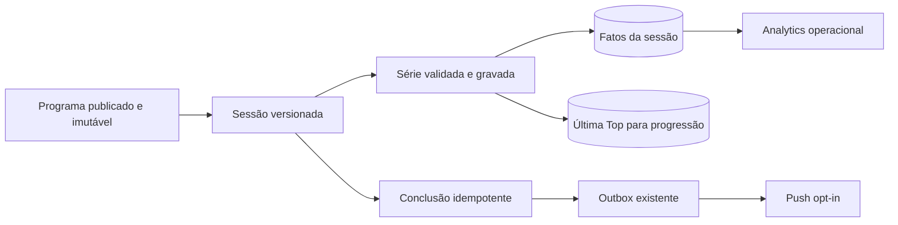

# Curva — fundação implementada e plano crítico revisado

**Revisão:** 13/10/2026. **Estado:** fundação aplicada; PostgreSQL local recebeu a cadeia até `0042`, Django check e checagem de migrations passaram. O fluxo em navegador e a entrega em dispositivo/produção ainda exigem validação. O código em runtime e os dados reais prevalecem sobre este plano.

## Atualização operacional desta rodada

- O PostgreSQL local (`127.0.0.1:5433`) estava parado. O contêiner existente `octobox_postgres_local` foi iniciado; `migrate_schemas --shared --noinput` aplicou a cadeia até `0042_training_session_outcome`; `migrate_schemas --noinput` não encontrou mais migrações a aplicar. `makemigrations --check --dry-run` não detectou divergência. Este banco local não equivale ao ambiente público.
- Um circuito transacional descartável no PostgreSQL encontrou e corrigiu um lock inválido (`FOR UPDATE` com join opcional). Depois disso, duas Top de uma faixa 2–3× concluíram a sessão, o parcial ficou separado no analytics, a série livre sem carga/reps foi registrada e o retry idempotente não duplicou fato. As transações de verificação foram revertidas.
- A faixa `2–3×` agora gera duas séries mínimas e uma opcional. A interface permite passar da etapa depois do mínimo. Texto sem contagem confiável abre registro livre, rotulado no dado como `legacy_unknown`; o aluno decide o número de séries até o limite de 30. A conclusão integral exige as mínimas e ao menos uma série por exercício livre. O aluno pode encerrar como parcial a qualquer momento; esse estado entra em indicador separado no analytics.
- Séries e encerramento iniciados numa sessão já aberta ficam em IndexedDB por conta. Falha de rede ou 5xx põe o comando na fila; a interface mostra pendências. O envio é sequencial ao voltar a conexão ou a aba. Falhas 4xx exigem resolução explícita, sem descartar dados. Iniciar uma sessão nova ainda precisa de rede para obter o identificador do servidor; sincronização com o app fechado depende da próxima abertura.
- A outbox antiga de cargas passou a usar banco local separado por conta. Dados do banco legado sem identidade conhecida não são reenviados automaticamente, para não atribuir cargas ao aluno errado. O service worker parou de armazenar HTML privado e a resposta HTML marca `Cache-Control: private, no-store`; o cache antigo é removido na ativação da nova versão.
- O `.env` local ignorado pelo Git recebeu um par VAPID novo, allowlist de provedores e URL de desenvolvimento. A chave privada foi validada pelo parser e `push_configured()` retornou `True`. O comando de drenagem da outbox executou com zero mensagens; entrega real depende de inscrição de dispositivo e da configuração equivalente no servidor público com HTTPS e timer ativo.

## 1. Objetivo do produto

O aluno abre o treino do dia, entende a meta e a origem da carga, registra cada série, retoma após interromper e finaliza uma sessão que aparece no analytics da equipe. A home oferece um clique simples para ativar ou desativar avisos do dispositivo. Os avisos relevantes incluem programa novo; a rede de push não deve atrasar o treino. A interface precisa manter a linguagem visual Curva/OctoBox e ser clara no celular.

## 2. O que esta fundação entregou

| Capacidade | Implementação agora | Limite atual |
|---|---|---|
| Versão do treino | A sessão aponta para o [`PublicWorkoutProgram`](../../public_workouts/models.py) publicado e imutável; migração [`0041`](../../public_workouts/migrations/0041_training_session_program.py). | Sessões antigas sem vínculo não podem ser guiadas pela nova regra; publicação no meio da sessão exige recomeçar na versão atual pela interface. |
| Início e retomada | [`training_sessions.py`](../../public_workouts/training_sessions.py) serializa início por conta, reutiliza sessão recente e aceita chave de início; GET de `/sessao` devolve progresso. | A janela de retomada é 36 horas; iniciar sem rede ainda não é suportado. |
| Série e carga | O servidor confere dia, movimento, ordem e papel contra a versão publicada. A última Top relevante grava `TrainingSet` e referência no `LoadLog` dentro de uma transação. | Não há correção de uma série confirmada nem política para pular séries. Outras Top continuam como fatos de sessão, fora da referência resumida de progressão. |
| Conclusão | Aceita séries mínimas de cada exercício, respeita opcionais e conta exercícios livres; encerramento parcial guarda o que foi realizado em estado distinto. | Correção de série confirmada ainda exige caso de uso próprio. |
| Interface | O [painel guiado](../../templates/public_workouts/partials/_guided_workout.html) tem os próprios campos de série, escolha de série opcional, série livre e encerramento parcial. Retomada e timer usam horário final no dispositivo. | Descanso ainda tem padrão fixo de 90 s; a validação visual real segue pendente. |
| Analytics | [`training_analytics.py`](../../public_workouts/training_analytics.py) alimenta painel e snapshot com uma agregação SQL, incluindo treinos parciais em indicador próprio. | Lista mostra identificador de plano, não uma ficha operacional completa do aluno. Definição de coorte precisa ser acompanhada em produção. |
| Push | Consentimento e desativação na home; hosts permitidos por configuração; boas-vindas, programa publicado e conclusão entram na [`outbox`](../../public_workouts/outbox.py) existente. | Depende de VAPID, `PUBLIC_WORKOUT_PUSH_ALLOWED_HOSTS`, URL pública e worker agendado. Renovação automática de subscription e cobertura real de navegadores ainda faltam. |
| PWA e privacidade | HTML privado não entra mais no cache do service worker; filas novas são separadas por conta. | Dados legados sem dono ficam preservados localmente para recuperação assistida; abrir o treino sem rede depois de fechar o app mostra a página offline genérica. |

**Observação sobre arquivos grandes:** `workout.html`, `load_tracker.js`, `workout-shell.css` e a view pública principal ainda são extensos. O código novo foi separado por capacidade. Refatorar esses arquivos antigos agora, junto da correção funcional, aumentaria a área de regressão; o split mecânico deve ser uma frente própria depois de mapear os consumidores.

## 3. Segundo embate: onde o plano anterior estava bom e onde se emaranhava

| Leitura | Ponto forte | Onde quebrava / custo oculto | Solução escolhida ou revisão |
|---|---|---|---|
| **Arquitetura** | Pedia fronteira para iniciar, registrar, retomar e concluir. | Propunha snapshot novo e possivelmente uma fila nova, apesar de o repositório já ter programa imutável e outbox. Isso criaria duas fontes de versão e duas rotinas de retry. | Sessão referencia a versão publicada; notificação reutiliza a outbox. O caso de uso está em `training_sessions.py`, fora da view. |
| **Debugger** | Identificou import quebrado, widget ausente, conclusão vazia e resposta de erro após gravação. | Corrigir apenas o import deixaria rede push e carga como efeitos separados, ainda produzindo “falhou na tela, salvou no banco”. | Conclusão não faz chamada externa; carga Top e série compartilham transação; exercício sem carga usa campos próprios. |
| **Segurança** | Rejeitou confiança em índices e papéis enviados pelo navegador. | Uma validação rígida só de formato aceitaria séries falsas; uma lista de hosts hardcoded poderia envelhecer. | Validação contra programa imutável no servidor e allowlist configurada no ambiente. Ainda precisa de limite de ritmo e revisão de política de dados offline. |
| **SQL e desempenho** | Defendeu lock, idempotência e agregador único. | Uma tabela nova de eventos por cada mudança de série seria cara e desnecessária para os quatro indicadores atuais. | Fatos em `TrainingSet`, estado em `TrainingSession`, leitura SQL agregada e outbox já existente. Reavaliar índice quando houver volume real. |
| **UX e design** | Pediu etapa única e fonte de carga legível. | Abrir e clicar o formulário antigo por JS tornava a tela dividida e frágil; polir CSS antes disso só esconderia o problema. | Painel único de execução com peso, reps, RIR, progresso e fonte da carga; tokens da marca e CSS local. |
| **Expert EF** | Separou Prep, Feeder e Top. | Texto livre pode ser ambíguo; converter toda expressão em pelo menos uma série inventa prescrição. Percentuais da rampa não são regra universal para todo exercício. | O parser só guia contagens explícitas. A fase seguinte é estruturar e revisar séries na publicação, mantendo kg editável e indicação de origem. |

**Decisão principal:** manter monólito modular, sessão versionada e uma única transação para o fato realizado. A forma mais barata e segura usa estruturas existentes. O ganho “brilhante” aqui é tornar a fonte da carga e o recibo da série claros para o aluno e para a equipe, em vez de somar uma camada técnica invisível.

## 4. Onde ainda quebra

### Bloqueadores de ativação ampla

1. **Amostra de programas e fluxo real:** migrações e checks passaram no PostgreSQL local vazio; ainda faltam sessão de aluno real, duas abas, reconexão, telas móveis e validação da publicação no ambiente público. O checkout contém migrations de outras frentes não versionadas, que precisam ser integradas com cuidado.
2. **Prescrição estruturada na origem:** o adaptador agora preserva faixas e oferece série livre quando não entende o texto. Isso tira o bloqueio do aluno, mas o editor deve apresentar papel, mínimo/máximo e descanso como dados estruturados antes da publicação para reduzir registros `legacy_unknown`.
3. **Correção e substituição de exercício:** o parcial já tem saída honesta. Alterar uma série confirmada ou trocar exercício ainda pede comando específico e reconciliação com o `LoadLog` para não criar progressão incorreta.
4. **Offline com limite explícito:** fila por conta cobre série e encerramento de sessão já iniciada. Iniciar sem rede, sincronizar com app fechado e resolver conflito 409 pelo próprio aluno ainda faltam. A política evita envio sob conta diferente e mantém 4xx pendente para intervenção.
5. **Push público exige operação real:** VAPID local foi configurado e validado; no servidor público ainda são necessários chave persistente, domínios aceitos, URL HTTPS e timer de `drain_public_workout_outbox`. É necessário validar inscrição, entrega, clique e revogação em aparelhos instalados.
6. **Privacidade e recuperação legada:** HTML privado não fica em cache; fila nova e outbox de carga atual são separadas por conta. O IndexedDB anterior à partição pode conter rascunhos sem identidade verificável; não deve ser migrado automaticamente. Um caminho assistido de exportação/limpeza ainda falta.

### Melhorias relevantes, porém não bloqueiam a fundação

- `start_key` cobre retry de início, mas um treino retomado de versão antiga só pode recomeçar no programa atual; a sessão antiga aparece como iniciada e não concluída. Falta estado `abandoned` ou `cancelled` para distinguir isso no analytics.
- Uma série já registrada com valores diferentes recebe conflito 409. Falta o caso de uso de correção com vínculo ao `LoadLog` quando a última Top é corrigida.
- O descanso de 90 s agora não deriva da prescrição. Quando o editor tiver `rest_seconds`, o timer deve usar esse valor e guardar o prazo no servidor ou no comando de série, não só no armazenamento local.
- O fallback da última carga está rotulado como referência, mas ainda pode alimentar automaticamente a rampa Prep/Feeder. O profissional deve poder confirmar ou trocar a âncora no programa.
- As sessões recentes mostram plano, dia, horário, estado e séries. Uma visão por aluno, com permissões próprias e contexto de treino, continua pendente.
- A allowlist de host reduz a superfície de push, mas precisa ser configurada com os domínios efetivos dos provedores usados nos dispositivos suportados; DNS e entrega externa ainda são operação, não garantia de código.
- A folha de estilo foi organizada e passou a usar tokens; falta inspeção em tema claro/escuro, celular, contraste, teclado e PWA instalada.

## 5. Plano de execução corrigido

### Portão A — integrar a fundação no ambiente de ensaio (prioridade máxima)

**Fazer:** conferir `makemigrations --check`, aplicar cadeia 0040→0041 em PostgreSQL de ensaio, verificar URL pública, service worker atualizado e configuração do worker de outbox. Executar o circuito iniciar → Prep/Feeder/Top → recarregar → concluir → conferir `TrainingSet`, `LoadLog`, analytics e mensagem enfileirada. Cobrir repetição, duas abas, exercício sem campo de carga, NaN, troca de programa e falha de push.

**Pronto quando:** uma única conclusão e uma única última Top por operação; erro 4xx para payload adversarial; o treino termina mesmo com push fora; números do painel batem com o banco; o aparelho não recebe HTML de outra conta via cache. **Contenção:** manter o acesso ao guia sob flag até passar, com registro manual funcionando.

### Portão B — prescrição estruturada na publicação

**Fazer:** adicionar `series[]` por movimento ao schema publicado, com identificador estável, papel, faixa de reps, descanso, carga/âncora opcional e origem. Editor e revisão profissional apresentam a conversão do texto legado. `guided_workout.py` fica como adaptador para programas antigos, não como verdade permanente. Separar sugestão de carga de fato realizado no payload.

**Pronto quando:** uma amostra de programas reais gera o número certo de séries; qualquer ambiguidade aparece antes de publicar; sessão iniciada continua na sua versão após nova publicação. **Economia:** não criar tabela de snapshot; usar a linha publicada imutável.

### Portão C — treino parcial, correção e rotina offline

**Fazer:** comandos explícitos `skip_set`, `correct_set`, `cancel_session` com motivo/estado; correção de última Top atualiza progressão de forma rastreável; fila local de comandos idempotentes com separação por conta, visibilidade de “pendente” e reconciliação após reconexão. Política do produto define se “parcial” entra na taxa de conclusão ou indicador próprio.

**Pronto quando:** nenhuma série pulada conta como executada; correção não cria recorde falso; offline nunca exibe “enviado” antes de confirmação; logout não transfere comandos de um aluno a outro.

### Portão D — acabamento visual e split legado

**Fazer:** avaliar o guia em telas reais; posicionar progresso, fonte da carga e ação de confirmação sem rolagem excessiva; timer por descanso prescrito; estados vazios/erro/retomada. Mapear `template → include → CSS → JS → payload` antes de extrair `workout.html`, `load_tracker.js` e a view principal. Separar outbox de carga, widget, RIR e calculadora em módulos com contratos estáveis, uma mudança mecânica por vez.

**Pronto quando:** claro/escuro, teclado, leitor de tela e PWA instalada mantêm o fluxo; nenhuma regra CSS órfã é apagada sem evidência; tempo de carregamento e interação não pioram.

### Portão E — operação de push e analytics por aluno

**Fazer:** ativar VAPID e hosts em ambiente, observar a outbox, medir falhas por dispositivo; renovar subscriptions; definir limites de frequência, quiet hours e preferências por tipo de aviso. Evoluir analytics para lista por aluno/sessão com controle de acesso e estado `abandoned`/`partial`, sem misturar aquisição com execução.

**Pronto quando:** programa publicado chega em dispositivo inscrito; desativação impede novo envio; retries não geram spam; equipe localiza a sessão que compõe o total; falhas externas não alteram a transação do treino.

## 6. Sinais de decisão errada e reversão

- **Inconsistência:** `TrainingSet` confirmado sem a última Top correspondente no `LoadLog`, conclusão duplicada ou sessão sem programa versionado. Suspender guia e investigar transação/migration.
- **Experiência:** aumento de abandono no primeiro exercício, muitos conflitos 409 ou incapacidade de terminar treinos parciais. Priorizar Portão C antes de nova estética.
- **Operação:** fila de push cresce, env faltando, endpoints revogados persistem ou p95 de registro sobe. Pausar tópicos push; preservar sessões e analytics.
- **Privacidade:** HTML ou rascunho de aluno anterior aparece após troca de conta. Suspender cache privado e fila local até isolar dados por identidade.

## 7. Verificação desta revisão

Foram feitos leitura de código e documentação, checagens de sintaxe Python/JavaScript, `manage.py check`, `makemigrations --check --dry-run`, migração do schema compartilhado local, circuitos transacionais descartáveis para série prescrita/livre, parcial, analytics e idempotência, e drenagem vazia da outbox. O par VAPID local foi validado sem expor a chave. Não foram executados testes de navegador/dispositivo nem deploy no ambiente público nesta revisão. As alterações de outras frentes presentes no checkout foram preservadas.
