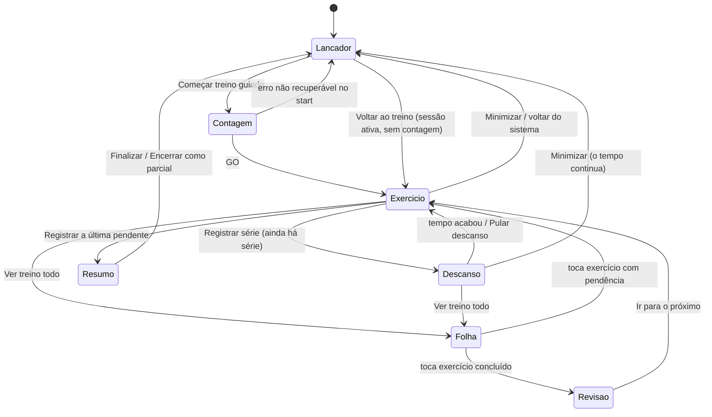

<!--
ARQUIVO: plano de arquitetura, UI/UX e performance do "modo foco" do treino guiado da Curva.
STATUS: ondas 1 e 2 implementadas em 14/10/2026 (ver "Estado da implementação"); onda 3 parcial.
ESCOPO: execução do treino guiado no corredor /renan/<slug> (template unificado workout.html).
DEPENDE DE: fundação do guiado já no checkout (sessão versionada, comandos, outbox IndexedDB) —
  ver curva-treino-guiado-plano-tecnico-rag.md e curva-treino-guiado-analytics-push-plano-critico.md.
FRONTEIRA: camada de apresentação + um ajuste de sincronização no cliente; servidor inalterado nas ondas 1–3.
SKILLS USADAS: performance_architect (orçamento de latência) e octobox-taste-design-ui-ux-personality
  (regras da casa aplicadas a um componente dentro do app; octobox-design continua vencendo no tema).
-->

# Curva: modo foco do treino guiado

## Estado da implementação (14/10/2026)

O protótipo foi validado pelo produto antes da implementação. O que existe no checkout:

| Peça | Arquivo | Contrato |
|---|---|---|
| Regra pura | [`guided-state.js`](../../static/js/public_workouts/guided-state.js) | Cursor `focusIndex`, `overview`, `upNext` e regra de concluído/pulado. |
| Textos | [`guided-format.js`](../../static/js/public_workouts/guided-format.js) | Rótulos, meta, CTA, origem da carga e validação de entrada; puro. |
| Anel | [`guided-ring.js`](../../static/js/public_workouts/guided-ring.js) | Contagem 3-2-1-GO e descanso esvaziando; agendador injetável. |
| Relógio | [`guided-timer.js`](../../static/js/public_workouts/guided-timer.js) | Horário final e total por sessão, pular, +30 s e `onEnd` único. |
| View | [`guided-focus.js`](../../static/js/public_workouts/guided-focus.js) | `<dialog>`, telas, folhas, rascunho por série e eventos `guided:*`. Sem fetch nem IndexedDB. |
| Controlador | [`workout-guided.js`](../../static/js/public_workouts/workout-guided.js) | Comandos, fila, cursor e view model. Não pinta a execução. |
| Marcação | [`_guided_workout.html`](../../templates/public_workouts/partials/_guided_workout.html), [`_guided_focus.html`](../../templates/public_workouts/partials/_guided_focus.html) | Lançador na aba Treino; o `<dialog>` fica no fim do `<body>`. |
| Estilo | [`workout-guided.css`](../../static/css/public_workouts/workout-guided.css), [`workout-guided-focus.css`](../../static/css/public_workouts/workout-guided-focus.css) | Tokens locais em `.guided-focus`. |

**Desvios do plano, com motivo:**

- **Sem flag de ativação.** O guiado não tinha flag, e manter o painel antigo e o modo foco em paralelo dobraria o controlador. A reversão é pelo commit.
- **Onda 3 parcial.**
  - A transição otimista ficou pronta: o descanso começa no toque, e o recibo vai de "Salvando…" para "✓ Salvo" ou "Salvo no aparelho". Se o servidor recusar, a série volta para a tela com o erro.
  - O "refresh apaga digitação" foi resolvido pelo desenho: o rascunho mora na view, indexado pela série.
  - A gravação local antes do envio (write-ahead) ainda não foi feita.
- **Ajuste de cópia:** em prescrição estruturada, a meta só mostra RIR quando a etapa define `rir_target`. Assim o aquecimento não herda o RIR do texto do programa.

**Verificação:**

- 33 testes Node em `tests/js` e 934 testes Python da Curva passaram, além do `manage.py check`.
- O fluxo foi exercido no servidor local contra o banco: contagem, série, descanso, pular, salto, revisão, correção, recarga com `#treino-guiado`, minimizar/voltar, pulo com desfazer e encerramento parcial.
- Capturas a 390 px nos temas escuro e claro foram feitas com Edge headless. Os dados de teste locais foram apagados depois.
- O e2e Playwright (`tests/e2e/test_curva_guided_session_e2e.py`) passou em 8/8 cenários, duas vezes seguidas, e também na variante de 390×844.
- O e2e pegou uma regressão, já corrigida. O widget da grade bloqueava o registro quando havia `[data-workout-guided-active]` visível, e esse atributo passou para o `<dialog>`, que nunca fica `hidden`. Agora a trava lê `[data-guided-session-active]` no lançador, ligado só com sessão aberta.
- No mesmo teste, `wait_for_function` com string era bloqueado pela CSP (sem `'unsafe-eval'`). Passou a usar espera via `page.evaluate`.
- **Também ficaram pendentes:**
  - PWA instalada no iPhone, indo ao MuscleWiki e voltando;
  - fila offline em aparelho real;
  - itens da onda 4.

## 0. Decisão

**A execução do treino guiado sai do painel inline e passa para uma camada de tela cheia, o modo foco.** O fluxo é contagem 3-2-1-GO, depois um exercício por tela com séries e carga recomendada. Ao registrar, o mesmo anel conta o descanso, com **Pular descanso** logo abaixo. **Ver treino todo** abre a lista completa: o que já foi feito aparece riscado e continua tocável.

O que **não** muda:

- Servidor, sessão versionada e comandos (`start`, `set`, `skip`, `unskip`, `correct`, `complete`, `partial`, `cancel`).
- Fila IndexedDB por conta, analytics e push.
- A **grade de exercícios com o widget de carga continua existindo**. O plano de carga (§7, "convivência") já decidiu que o modo treino é opcional e não fica na frente de todo registro.

As ondas 1 e 2 mexem só no front-end. A onda 3 ajusta a sincronização no cliente.

**Como as skills entraram:**

- A taste skill foi aplicada no modo "componente dentro de um produto existente". Por isso não rodamos `draw.mjs`: a direção visual já é o tema Curva/OctoBox.
- As regras da casa (sem eyebrow, sem gradiente, sem vidro, sem sombra em repouso, números grandes, uma ação principal por tela) valem **dentro da camada**, onde não conflitam com os tokens do tema.
- Nenhuma variante do pacote foi carregada. Elas tratam de landing, página ou geração de imagem, e esta é uma tela de app.

## 1. Pedido → decisão

| Pedido | Decisão de produto | Base técnica existente |
|---|---|---|
| Ao clicar, cronômetro estilo Nike 3, 2, 1, GO com círculo girando a cada segundo | Camada de contagem. O anel dá **uma volta completa por número** e termina em GO. O `POST start` dispara **no toque**, em paralelo à contagem. | `start_key` idempotente e caminho offline do `start` em [`workout-guided.js`](../../static/js/public_workouts/workout-guided.js) |
| Depois abre só o próximo exercício | Tela de exercício: nome, série X de Y, meta, carga recomendada, campos e um CTA. | `data-guided-series` de cada card em [`workout.html`](../../templates/public_workouts/workout.html) |
| Aparecem as séries e o peso recomendado | Carga já preenchida com a sugestão e a origem escrita embaixo ("Sugestão da fase · ajuste se precisar"). Meta de reps e RIR alvo visíveis. | `weight_kg`, `load_source`, `reps`, `reps_max`, `rir_target` em [`guided_prescription.py`](../../public_workouts/guided_prescription.py) |
| Ao registrar, o mesmo cronômetro com o tempo de descanso | O mesmo anel esvazia durante `rest_seconds`. Nos últimos 3 s ele volta ao ritmo 3-2-1 e termina em GO. | `rest_seconds` (0–900) por estágio; legado usa 90 s ([`guided-timer.js`](../../static/js/public_workouts/guided-timer.js) já guarda o horário final) |
| Opção embaixo: Pular descanso | Botão de texto grande abaixo do anel. | Novo, só no cliente |
| Segue o fluxo de peso/série | Próxima série do mesmo exercício; ao fim do exercício, o próximo. | `CurvaGuidedState.project` em [`guided-state.js`](../../static/js/public_workouts/guided-state.js) |
| Clicar no nome abre o vídeo no MuscleWiki, igual ao app normal | Nome é link para o mesmo `movement.reference_url`, em nova aba, como na grade. O estado sobrevive à saída (horário final e IndexedDB). | Mesmo campo usado em `workout-wiki-link` |
| Botão "Ver treino todo" no canto superior direito, com pop-up e salto para o exercício | `<dialog>` em folha com todos os exercícios do dia. Tocar num exercício leva até ele no modo foco. | Novo cursor de foco no estado puro (§6.2) |
| Exercício feito fica riscado, mas ainda abre | Nome riscado (`<s>`) com "concluído" acessível e contagem de séries. Abre em **modo revisão** (séries feitas e correção). | Comando `correct` já existe |

## 2. Estado atual reaproveitado e lacunas encontradas

| Peça | Estado no checkout |
|---|---|
| [`_guided_workout.html`](../../templates/public_workouts/partials/_guided_workout.html) | Painel inline com campos e **nove botões de ação no mesmo bloco**, incluindo pular, desfazer, extra, finalizar, parcial, cancelar e corrigir. |
| [`workout-guided.js`](../../static/js/public_workouts/workout-guided.js) | Controlador (~590 linhas). Monta `movements` lendo o DOM dos cards (`buildMovements`) e despacha comandos via `CurvaGuidedSync`. |
| [`guided-state.js`](../../static/js/public_workouts/guided-state.js) | Projeção pura. `next` é sempre a **primeira série pendente em ordem**; não existe cursor. |
| [`guided-timer.js`](../../static/js/public_workouts/guided-timer.js) | Guarda `endAt` em `localStorage` por sessão e pinta só texto ("Descanso · 1:24"). Não tem anel, pular, "a seguir" nem callback de fim. |
| [`guided-sync.js`](../../static/js/public_workouts/guided-sync.js) | `deliver()` online **espera o POST** antes de devolver. Com fila pendente, enfileira e drena. Depois de drenar com a fila vazia, faz `GET /sessao`. |
| [`public_workout_sessions.py`](../../student_app/views/public_workout_sessions.py) | `set` responde `{ok, created, set_id}`. `GET` devolve a sessão (recorded/skipped). |
| [`public_workout_pwa.py`](../../student_app/views/public_workout_pwa.py) | Listas `PUBLIC_WORKOUT_UNIFIED_TEMPLATE_STYLES/SCRIPTS` alimentam o precache do service worker. Asset novo precisa entrar nelas. |
| [`test_curva_guided_session_e2e.py`](../../tests/e2e/test_curva_guided_session_e2e.py) | **60 seletores `data-workout-guided-*`**. A nova UI mantém esses atributos nos elementos equivalentes para não reescrever o e2e. |

**Lacunas que o modo foco obriga a resolver:**

1. **Sem cursor.** `project()` só conhece "a primeira pendente". Pular para outro exercício exige um cursor explícito (§6.2).
2. **Tempo morto ao registrar.** Online, o botão fica travado durante um RTT inteiro antes de pintar a próxima série e iniciar o descanso. Em 4G de academia isso fica em ~0,3–1,5 s (estimativa a medir). No modo foco, isso aparece como o anel "atrasado".
3. **Refresh apaga digitação.** Depois de uma drenagem, `onRefreshed → activate() → paintStep()` **zera os campos de carga e reps**. No modo foco, o aluno já estará digitando a próxima série quando o GET voltar.
4. **`buildMovements` lê `textContent` do nome** e não captura o `reference_url`. Precisa de `data-*` explícito.
5. **Carga cognitiva.** Todas as ações aparecem ao mesmo tempo. O modo foco separa ações da série (na tela) de ações do treino (na folha).

## 3. Fluxo e estados



**Regras:**

- **Retomada não repete a contagem.** Se o app abrir com sessão ativa, o lançador mostra "Treino em andamento · Exercício 3 de 7" e **Voltar ao treino**. A camada só abre direto quando a URL tem `#treino-guiado`, que é o caso de recarregar depois do MuscleWiki.
- **Cursor de foco.**
  - `focusIndex = null` significa automático: a primeira série pendente em ordem de prescrição.
  - Pular para o exercício M grava `focusIndex = M`.
  - Quando M fica sem pendência, o cursor volta ao automático. Isso cobre o caso real "aparelho ocupado: fui do 3 para o 5 e, ao terminar o 5, volto ao 3".
  - **Pular para um exercício não marca nada como pulado.**
- **Concluído (riscado)** = todas as séries obrigatórias registradas e pelo menos uma registrada. Série opcional pendente não impede o risco, mas continua acessível. Exercício com séries só puladas aparece como **"pulado"**, sem risco: pular não é fazer.
- **Descanso entre exercícios também existe.** A tela mostra "A seguir: <próximo exercício>". Depois da última pendente do treino, não há descanso: vai direto ao resumo.
- **`rest_seconds: 0`** (biset ou superset prescrito) pula a tela de descanso.
- **Encerrar continua explícito.** O resumo não finaliza sozinho. Faltando obrigatórias, a ação principal vira "Encerrar como parcial" e a tela lista o que falta.

## 4. Telas (referência a 390 px)

Os wireframes mostram estrutura, não estilo. Os valores são exemplos.

**4.1 Contagem**

```text
┌──────────────────────────────────┐
│                                  │
│           ╭──────────╮           │
│         ╱              ╲         │  anel: 1 volta por segundo
│        │       3        │        │  número 160–200 px
│         ╲              ╱         │
│           ╰──────────╯           │
│                                  │
│      Supino reto com barra       │  primeiro exercício, em leitura
│                                  │
└──────────────────────────────────┘
3 → 2 → 1 → GO (≈3,2 s). Tocar na tela pula a contagem.
```

**4.2 Exercício**

```text
┌──────────────────────────────────┐
│ ⌄ Minimizar      Ver treino todo │
│ Exercício 3 de 7                 │
│                                  │
│ Supino reto com barra ↗          │  link MuscleWiki · até 2 linhas
│ Série principal · 2 de 4         │
│ Meta 8–10 reps · RIR 2           │
│                                  │
│ Carga                            │
│ [ − ]       62,5 kg       [ + ]  │  já vem com a sugestão
│ Sugestão da fase · ajuste se precisar │
│                                  │
│ Repetições                       │
│ [ − ]          —          [ + ]  │  primeiro "+" preenche a meta (8)
│                                  │
│ Esforço · opcional             ⌄ │
│                                  │
│ [    Registrar 62,5 kg × 8    ]  │  CTA 56 px, texto reflete os dados
│ Pular série · Corrigir anterior  │  ações da série, em texto
│ 1 série aguardando envio         │  só quando houver pendência
└──────────────────────────────────┘
```

- Carga e reps têm stepper. Tocar no número abre teclado decimal ou numérico; os rótulos ficam sempre visíveis.
- O incremento da carga segue o equipamento (2,5 kg padrão), como no plano de carga.
- A carga realizada nunca sobrescreve a sugestão. A origem continua escrita, inclusive "Referência da última sessão, não uma prescrição".
- Exercício sem carga (`allow_load_registration = false`) mostra só reps.
- Série livre (`legacy_unknown`) mostra "Quantidade livre" e **Adicionar série**.

**4.3 Descanso**

```text
┌──────────────────────────────────┐
│ ⌄ Minimizar      Ver treino todo │
│                                  │
│           ╭──────────╮           │
│         ╱    1:24      ╲         │  anel esvazia ao longo do descanso
│        │  62,5 × 8 ✓    │        │  recibo da série dentro do anel
│         ╲              ╱         │
│           ╰──────────╯           │
│                                  │
│ A seguir                         │
│ Supino reto · série 3 de 4       │
│ 62,5 kg · meta 8–10              │
│                                  │
│        [ Pular descanso ]        │
└──────────────────────────────────┘
Últimos 3 s: o anel volta a 1 volta/s com 3-2-1 e GO, depois abre a tela 4.2.
Recibo: "Salvando…" → "✓ salvo" ou "Guardado neste aparelho".
```

**4.4 Ver treino todo (folha `<dialog>`)**

```text
┌──────────────────────────────────┐
│ Peito e tríceps            Fechar│
│                                  │
│ ✓ Supino reto (riscado)     4/4  │
│ ✓ Crucifixo (riscado)       3/3  │
│ ▶ Supino inclinado   Agora · 1/3 │
│   Tríceps corda             0/3  │
│   Mergulho                Pulado │
│                                  │
│ Encerrar como parcial            │  ações do treino ficam aqui
│ Cancelar sessão                  │
│ Som da contagem: desligado       │
└──────────────────────────────────┘
```

**4.5 Revisão (exercício concluído aberto pela folha):** nome riscado, lista "Série 1 · 60 kg × 10 ✓", **Corrigir uma série** (comando `correct`) e o CTA **Ir para o próximo: Tríceps corda**.

**4.6 Resumo:** "Treino concluído", duração, séries feitas, exercícios concluídos e CTA **Finalizar treino**. Com obrigatórias faltando: "Faltam 2 séries obrigatórias", CTA **Encerrar como parcial** e o link "Voltar ao treino".

**4.7 Lançador inline (no lugar do painel atual):**

- Sem sessão: "Treino guiado · Uma série por vez, com descanso cronometrado" e **Começar treino guiado**.
- Com sessão: "Em andamento · Exercício 3 de 7 · descanso 0:45" e **Voltar ao treino**.

### 4.8 Texto da interface (pt-BR)

| Lugar | Texto |
|---|---|
| CTA de série | `Registrar 62,5 kg × 8` · `Registrar 62,5 kg` · `Registrar 8 reps` · `Registrar série` (sem dados obrigatórios) |
| Descanso | `Pular descanso` · `A seguir` · `Descanso concluído` |
| Recibo | `Salvando…` · `Salvo` · `Guardado neste aparelho · envio pendente` · `Não foi aceito · corrigir` |
| Topo | `Minimizar` · `Ver treino todo` · `Exercício 3 de 7` |
| Folha | `Agora` · `Pulado` · `3/4` · `Encerrar como parcial` · `Cancelar sessão` |
| Link | Nome acessível: `Ver Supino reto no MuscleWiki (abre em nova aba)` |

## 5. Direção visual: Curva + regras da casa

**Ideia:** neste modo, **o recibo da série que acabou de ser salva** vira **o centro do anel de descanso**. O anel guarda o que você acabou de fazer e esvazia até a próxima série. Os planos anteriores já pedem "recibo claro da série". Aqui o recibo vira o próprio relógio, em vez de um toast que some.

**O elemento interativo da tela** é o anel único. É ele que conta o início, o descanso e o retorno ao exercício.

| Elemento | Especificação |
|---|---|
| Fundo da camada | Cor chapada do tema (`--theme-bg-root` no escuro; superfície clara equivalente no claro). Sem `--theme-bg-stage`, sem glow radial, sem `backdrop-filter`. |
| Tokens | Variáveis locais declaradas **em `.guided-focus`, não em `:root`**. Valor derivado em `:root` congela no tema claro: é a pegadinha `--ink` registrada em `public-workouts-produtizacao-corda.md`. |
| Acento | Um só: `--brand` (respeita as variantes premium e support do corredor) no anel, no CTA e no foco. `--theme-accent-success` só no ✓ do recibo. Neon abaixo de ~10% da área. |
| Tipografia | `--font-display`/`--font-body` atuais, com números tabulares. Cinco tamanhos no máximo: contagem 160–200 px; tempo de descanso 72–88 px; carga 40 px e reps 32 px; nome do exercício 28–32 px (24 px quando `data-long`, nunca mais de 2 linhas, `text-wrap: balance`); texto 16–17 px. Display com tracking −0,03em. |
| O que sai | O eyebrow "SESSÃO CURVA" em caixa alta espaçada, bordas de 1 px entre grupos (trocadas por espaço e degrau de tom), gradiente de fundo e sombra em repouso. **Sombra só na folha**, que de fato flutua. |
| Anel | SVG, traço de 10–12 px, trilho em degrau de tom (não linha fina) e progresso em `--brand`. Caixa de 240–280 px no celular. |
| Botões | Altura 56 px no CTA e alvos de pelo menos 48 × 48. O raio segue o token já usado no guiado (12 px): a taste skill prefere quadrado ou pílula, mas aqui `octobox-design` vence por consistência. |
| Áreas seguras | `env(safe-area-inset-*)` na camada. Como `<dialog>` modal fica na *top layer*, a camada cobre a bottom nav e não disputa espaço com a barra fixa (atenção ao WebKit #237961 no PWA). |

**Movimento** (só `transform`, `opacity` e traço do SVG):

- **Contagem:** o número entra com escala 1,25→1 e opacidade em 120 ms; o anel varre 360° em 1 s linear. No GO, escala 0,9→1,05→1 e crossfade de 200 ms para a tela de exercício.
- **Registrar:** o CTA vira ✓ em 150 ms e a tela de descanso sobe em 220 ms.
- **Descanso:** varredura contínua pelo tempo total. Nos últimos 3 s, o mesmo efeito da contagem.
- **Risco:** quando um exercício fica concluído, o traço do risco se desenha uma vez (`scaleX` num pseudo-elemento) na folha.
- **`prefers-reduced-motion`:** sem varredura nem escala. O anel mostra progresso estático atualizado a cada segundo e os números trocam sem deslocamento.
- **Háptico:** `navigator.vibrate(30)` em cada 3-2-1 e 120 ms no fim do descanso, só onde existe (Android; iOS não expõe a API).
- **Som:** desligado por padrão, com opção na folha guardada por aparelho. O modo silencioso do iPhone também silencia Web Audio.

**Acessibilidade:**

- A camada é um `<dialog aria-labelledby>` aberto com `showModal()`, que já deixa o fundo inerte e prende o foco. `Esc` minimiza; nunca cancela.
- A contagem anuncia uma vez "Treino começa em 3 segundos" e depois "Valendo". Não anuncia cada número.
- O descanso usa `role="timer"` e anúncios educados em 60 s, 30 s, 10 s e "Descanso concluído".
- O estado nunca depende só de cor ou risco: `<s>` mais texto oculto "concluído", ícone e contagem.
- Com texto a 200%, steppers e ações quebram linha; não há rolagem horizontal.

## 6. Arquitetura do front-end

**Princípio:** mesmo controlador e uma nova view. Sem rota nova, sem endpoint novo, sem framework. O padrão segue o existente: IIFEs em `window.Curva*`, testáveis com `node:test` + `vm`.

### 6.1 Módulos

| Módulo | Tipo | Responsabilidade | Não faz |
|---|---|---|---|
| `guided-state.js` (evolui) | Puro | Recebe um objeto de opções com `focusIndex` e devolve `current` (série a mostrar), `mode` (`exercise`, `review` ou `summary`), `overview[]` (por exercício: índice, nome, status `done`/`active`/`pending`/`skipped`, feitas/obrigatórias/total) e `upNext`. Mantém a assinatura posicional antiga. | DOM, armazenamento |
| `guided-ring.js` (novo) | Componente | Anel SVG + número. `countdown(n, onDone)`, `rest({endAt, total}, onDone)`, `stop()`. Usa Web Animations com `currentTime` derivado do horário final, então a retomada fica correta. Tem ramo para movimento reduzido. | Persistência, regras de treino |
| `guided-timer.js` (evolui) | Estado do relógio | Mantém `endAt` por sessão e acrescenta `total`, `skip()`, `onEnd` (dispara uma única vez) e `remaining()`. A pintura de texto fica só no lançador inline. | Desenho do anel |
| `guided-focus.js` (novo) | View | Dono do `<dialog>`: pinta contagem, exercício, descanso, revisão, resumo e folha. Emite `CustomEvent` (`guided:record`, `guided:skip-rest`, `guided:jump`, `guided:minimize`, `guided:end`). Cuida de histórico/voltar e Wake Lock. | `fetch`, IndexedDB, comandos |
| `workout-guided.js` (afina) | Controlador | Conecta estado, sincronização, relógio e view; os comandos ficam iguais. O painel atual vira lançador. **Deve encolher, não crescer.** | Pintar a camada |
| `guided-sync.js` (onda 3) | Sincronização | Gravação local primeiro para `set`/`skip`/`unskip`; sem `GET` depois de recibos simples (§7). | |

### 6.2 Cursor e projeção (contrato do estado puro)

```js
CurvaGuidedState.project(movements, recorded, skipped, pendingCount, lastSkipped, lastFreeformIndex, {
  focusIndex: 4,          // null = automático
});
// → { next, current, mode, overview, upNext, canFinish, ... }
// next      = primeira pendente em ordem (inalterado)
// current   = primeira pendente do exercício focado; com foco sem pendência, mode = 'review'
// overview  = [{ index, label, status: 'done'|'active'|'pending'|'skipped', done: 3, required: 3, total: 4 }]
// upNext    = série que vem depois de current (para "A seguir" no descanso)
```

O `focusIndex` entra no snapshot local que já existe (`outbox.save`: `session_id`, `day_id`, `recorded`, `skipped` e agora `focus_movement_index`). Assim, recarregar depois do MuscleWiki volta ao exercício escolhido. Ele não vai ao servidor.

### 6.3 Template e dados

- `workout.html`: o card ganha `data-movement-label` e `data-reference-url`, e `buildMovements` lê esses atributos em vez de `textContent` e da âncora.
- O plano do dia é montado **uma vez por dia em memória**. Hoje cada `activate` relê e faz parse do JSON do DOM.
- `_guided_workout.html` passa a ser o lançador e inclui o novo `partials/_guided_focus.html` (markup do `<dialog>`, oculto e renderizado no servidor; o JS só preenche texto).
- Os atributos `data-workout-guided-*` ficam nos elementos equivalentes (CTA, pular, desfazer, extra, finalizar, parcial, cancelar, corrigir, conflito) para manter os 60 seletores do e2e.
- CSS novo em `static/css/public_workouts/workout-guided-focus.css` (`workout-guided.css` fica para o lançador). Os dois JS novos e o CSS entram em `workout.html` e nas listas de [`public_workout_pwa.py`](../../student_app/views/public_workout_pwa.py). Sem isso, o precache do service worker não os tem e a reabertura offline quebra.

### 6.4 Plataforma

- **Voltar do sistema:** abrir a camada faz `history.pushState(…, '#treino-guiado')` e `popstate` minimiza. O gesto de voltar do Android ou o swipe do iOS não tiram o aluno do app no meio da série.
- **MuscleWiki:** `<a target="_blank" rel="noopener">`, igual à grade. No PWA instalado do iOS isso sai do app e pode recarregar a página. A recuperação usa `#treino-guiado`, o snapshot com `focus_movement_index` e o `endAt` do descanso. Teste obrigatório em iPhone.
- **Tela acesa:** `navigator.wakeLock.request('screen')` enquanto a camada está aberta, pedindo de novo em `visibilitychange`. É liberado ao minimizar ou finalizar. Sem suporte, segue sem ele e sem aviso.
- **App em segundo plano:** o tempo é calculado pelo horário final, então volta correto. **Não há alarme com a tela bloqueada**, e o plano não promete isso. O Wake Lock reduz o caso.

## 7. Performance

**Orçamentos:**

| Interação | Alvo | Como chegar |
|---|---|---|
| Abrir o modo foco | 0 requisições, ≤ 1 frame após o GO | Markup pré-renderizado, plano do dia em memória |
| Início do treino | Latência do `start` invisível | `POST start` sai no toque, e os ~3,2 s da contagem cobrem o RTT. Se não voltar até GO + 2 s, `AbortController` e caminho offline existente (id local + fila). O `start_key` idempotente garante que um POST abortado que chegou ao servidor mapeia para a mesma sessão. |
| Registrar → descanso visível | ≤ 100 ms | Horário do descanso capturado **no toque**. Onda 2: transição imediata com recibo "Salvando…" (honesto: só vira ✓ com o recibo). Onda 3: gravação local primeiro, em ~5–20 ms. |
| Requisições por série online | 1 POST | A gravação local primeiro faria todo `set` passar pela drenagem, e a drenagem termina em `GET /sessao`, dobrando requisições. **Pular o `GET` quando só houve recibos de `set`/`skip`/`unskip`/`correct`.** Manter o GET depois do mapeamento do `start`, de conflito, de reconexão e de `visibilitychange`. |
| Atualização sem apagar digitação | 0 campos zerados | `onRefreshed` reconcilia `recorded`/`skipped` sem chamar `paintStep` nos campos. Uma flag de "editado" por série protege a carga e as reps em digitação. |
| Anel a 60 fps em Android médio | Sem layout por frame | Web Animations no traço SVG, pintura limitada à caixa do anel (`contain: strict`). O número troca uma vez por segundo com `setTimeout` alinhado ao próximo segundo (sem deriva), `tabular-nums` e largura fixa. Sem loop de `requestAnimationFrame`; animações canceladas com `document.hidden`. |
| Peso adicionado | ~9–12 KB JS + ~6 KB CSS sem minificar | Nenhuma biblioteca, fonte ou imagem; ícones em SVG inline; tudo em precache. |
| Servidor | 0 endpoints novos, 0 consultas novas nas ondas 1–3 | Tudo sai do DOM e dos comandos que já existem. |

**Antes e depois (estimado; medir no ensaio):**

| Métrica | Hoje | Alvo |
|---|---|---|
| Toques por série no caso comum (sugestão certa, meta batida) | ~4–5 (abrir teclado, digitar reps, fechar, registrar) | 2 ("+" preenche a meta, Registrar) |
| Toque até o descanso visível | 1 RTT (≈0,3–1,5 s), com botão travado | ≤ 100 ms |
| Espera visível no início | 1 RTT | 0, coberto pela contagem |
| Requisições por série online | 1 | 1, mesmo com gravação local primeiro |
| Campos zerados por refresh no meio da digitação | Possível depois de drenar a fila | 0 |

**Trade-off explícito:** a transição otimista mostra o descanso antes da confirmação do servidor. A confiabilidade fica mantida porque o recibo distingue "Salvando…", "Guardado neste aparelho" e "Salvo". Se o servidor recusar (400/409), o aviso aparece **na tela de descanso ou de exercício** com a ação de resolver; o descanso não é bloqueado. Até a onda 3, uma aba morta no meio do POST pode perder a série. Hoje essa mesma janela já existe, mas o aluno não viu confirmação. Por isso a onda 2 mostra "Salvando…" até o recibo chegar, nunca o ✓.

**Custo de bateria:** o Wake Lock é o maior custo e fica ativo só com a camada aberta.

## 8. Back-end

- **Nada obrigatório nas ondas 1–3.** O `rest_seconds` estruturado já existe, com 90 s no legado; `0` desliga a tela de descanso.
- **Futuro, decidir com dado:** gravar `rest_taken_seconds` no comando `set` (coluna anulável em `TrainingSet`, migration) para o profissional ver "descansa menos que o prescrito" no analytics. Fica fora deste plano até haver pedido da equipe; pular descanso fica só no cliente.

## 9. Ondas de entrega

| Onda | Conteúdo | Pronto quando | Reversão |
|---|---|---|---|
| **1. Estado e anel** | `guided-state.js` com cursor, `overview`, regra de concluído e `upNext`. `guided-ring.js`. `guided-timer.js` com `total`, `skip` e `onEnd`. Testes `node:test`. | Testes verdes e nenhuma mudança visível. | Não há (código não ligado). |
| **2. Modo foco (atrás de flag)** | `<dialog>`, contagem, exercício, descanso com pular, link MuscleWiki, folha com salto e risco, revisão, resumo, minimizar e voltar, Wake Lock, lançador, `data-*` no card, assets nas listas do PWA. | e2e cobre o fluxo novo; `inspect.mjs` da taste skill em 390, 768 e 1440 sem FAIL; escuro e claro; movimento reduzido; teste rápido com VoiceOver e TalkBack; iPhone com PWA instalado indo ao MuscleWiki e voltando. | Flag `CURVA_GUIDED_FOCUS_ENABLED` (ambiente → contexto da view) desligada volta ao painel atual. |
| **3. Gravação local primeiro + refresh sem reset** | `deliver` grava localmente antes para `set`/`skip`/`unskip`; sem GET depois de recibos; reconciliação sem zerar campos. | Cenários offline, reconexão, duas abas e troca de conta continuam verdes; 1 requisição por série; nenhum campo zerado. | Opção no `CurvaGuidedSync.create` volta ao `deliver` atual. |
| **4. Acabamento** | Decisões abertas (§11): +30 s, som, mini status na Home. | Piloto com alunos (§10). | Cada item é isolado. |

Cada onda é um PR revisável. Extração mecânica e mudança de comportamento não entram no mesmo commit, como já está em `curva-split-modularizacao-progressiva.md`.

## 10. Verificação

| Camada | Evidência |
|---|---|
| Estado puro (`tests/js/curva_guided_state.test.js`) | Salto para exercício posterior; volta à primeira pendente depois do focado; concluído com opcional pendente; série livre; exercício só pulado não fica riscado; `overview` correto; assinatura antiga preservada. |
| Anel e relógio (`tests/js/curva_guided_ring.test.js`, novo) | Restante a partir de `endAt`; `skip` dispara `onEnd` uma vez; remapeamento local→servidor; retomada no meio do descanso; movimento reduzido. |
| Template (`public_workouts/test_workout_template.py`) | `<dialog>` presente, `data-reference-url` e `data-movement-label` nos cards, lançador, assets novos nas listas do PWA. |
| e2e (`tests/e2e/test_curva_guided_session_e2e.py`) | Começar → contagem (relógio controlado do Playwright) → registrar → descanso → pular → folha → salto → risco → revisão → resumo → finalizar. Recarregar com `#treino-guiado` no meio do descanso. Voltar do sistema minimiza. Os cenários offline existentes continuam verdes. |
| Visual | `inspect.mjs` + crítica de capturas (taste skill §7–8) no template real; escuro e claro; 320 px; texto 200%. |
| Uso real | Piloto com ≥ 5 alunos. Metas (não medidas ainda): 2 toques por série no caso comum; descanso visível ≤ 100 ms no aparelho de referência; 4 de 5 usam salto e risco sem explicação; 0 séries perdidas ou duplicadas. |

## 11. Riscos e decisões abertas

**Onde pode quebrar:**

- **Teclado numérico no `<dialog>` do iOS** pode cobrir o CTA. Os steppers reduzem o uso do teclado; com teclado aberto, o CTA fica no fluxo e o campo focado rola para a vista (`visualViewport`).
- **Salto e esquecimento:** o aluno pula para frente e esquece um exercício. A folha mostra o que está pendente e o resumo lista as obrigatórias faltando antes de finalizar.
- **Grade e modo foco registrando ao mesmo tempo:** o widget da grade grava pelo `/carga` e o guiado não fica sabendo. Com sessão ativa, o widget da grade mostra "Treino guiado em andamento · registre por lá" (aviso, sem bloquear).
- **`workout-guided.js` crescendo de novo:** toda a pintura nova vai para `guided-focus.js`. O revisor recusa PR em que o controlador cresce.

**Decisões para você (com recomendação):**

1. **Botão +30 s no descanso**, além de Pular descanso? Recomendo **sim, na onda 4**: é o ajuste mais pedido em apps de treino e custa pouco.
2. **"GO" ou "VAI"** no fim da contagem? O pedido diz **GO**. Mantido, mas é uma linha de texto para trocar.
3. **Contagem também ao retomar a sessão?** Recomendo **não**: retomar é voltar ao trabalho, não começar.
4. **Som da contagem** ligado por padrão? Recomendo **desligado**, com opção na folha.
5. **Abrir o modo foco sozinho** ao reabrir o app com sessão ativa? Recomendo **só com `#treino-guiado` na URL**; no resto, um toque em "Voltar ao treino". Isso respeita a decisão de convivência com a grade.
