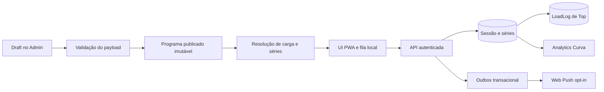

# Curva — plano técnico detalhado para treino guiado, cargas, offline, analytics e push

**Levantamento inicial:** 13/10/2026. As seções de execução dessa data são um registro histórico; a atualização operacional abaixo prevalece para o estado atual.

## Atualização operacional em 14/10/2026

O PR #327 está publicado no ambiente público. A inscrição e o recebimento de uma mensagem push direta foram confirmados pela destinatária em um iPhone com o Curva instalado. Clique na mensagem, desativação/reativação e aviso automático de conclusão de treino ainda precisam de verificação no aparelho; [o runbook de push](../runbooks/curva-push-operations.md) separa essas evidências.

O gargalo de kg está nos dados de partida, não só no cálculo. Uma leitura agregada do ambiente público encontrou 16 programas ativos com 389 movimentos; nenhum usa ainda `guided_prescription` estruturado. Em 14 pares conta–programa com assinatura ativa, 344 movimentos foram avaliados: 39 tinham kg resolvido e cerca de 300 não tinham âncora utilizável. Os números variam conforme alunos registram cargas. Predominam movimentos `load_type=free` com texto legado. A resolução continua na ordem: kg fixado pelo profissional → percentual de RM válido → fase → reps/RIR reconhecíveis → última Top elegível → escolha manual.

Neste ramo, o primeiro contorno operacional acrescenta um **alvo opcional da Top no treino guiado**. Sem kg automático, o aluno pode informar o peso que pretende tentar; o guia recalcula as sugestões de Prep/Feeder/Top com as regras já publicadas, respeitando o passo de arredondamento e sem substituir estágios com kg fixo. A escolha fica no snapshot local da sessão para sobreviver à retomada offline; só o peso efetivamente registrado em cada série vira fato no servidor e alimenta o histórico. O aluno pode ignorar ou apagar o alvo e registrar livremente. Isso beneficia os movimentos com séries reconhecíveis, sem inventar RM ou converter silenciosamente texto ambíguo.

Ainda falta passar novos programas pelo draft com `guided_prescription` revisado pelo profissional. Os programas publicados são snapshots imutáveis; não devem ser convertidos em lote sem revisão. O teste de ponta a ponta deste novo alvo foi acrescentado, mas sua execução local depende de liberar o banco de teste PostgreSQL compartilhado. A confirmação em PWA física, os cenários de atualização entre dispositivos e a observação do analytics durante um treino real seguem como próximos portões.

Na mesma leitura pública, o analytics contou 4 sessões iniciadas nos últimos 90 dias, nenhuma concluída, 1 parcial e 2 canceladas. A consulta direta dos fatos encontrou 1 série realizada em sessão ainda aberta; por isso `sets_completed=0` está coerente. Não há mensagem `training_completed` na outbox: o recebimento de push direto no iPhone não prova o disparo automático de conclusão. Fazer um treino de ensaio completo, sincronizar a fila e comparar sessão, séries, analytics e outbox é a próxima verificação operacional de baixo custo.

## Estado de execução em 13/10/2026

O contrato aditivo de estágios, a prévia de conversão revisada no Admin, o resolvedor de carga, os comandos de pular/desfazer/corrigir/cancelar, a trilha de correção Top–`LoadLog`, o início e envio pela fila IndexedDB, a resolução básica de conflito, o detalhe operacional no analytics e a renovação de inscrição push estão implementados no checkout. A ficha mínima por conta e a tela offline permitem fechar/reabrir o PWA sem rede; a fila usa sequência transacional e sincroniza ao reabrir o app conectado. O template unificado agora registra o service worker e publica o manifest. A interface usa módulos separados para prescrição, carga, decisões, transporte HTTP, fila local, cronômetro, PWA, endpoint push e analytics. A navegação desktop foi ajustada após inspeção visual; o mobile foi inspecionado em 390 px.

Verificação mais recente: 25 testes focados, 941 testes e 65 subtestes de regressão Curva com `--create-db --migrations`, sete cenários de navegador com migrations reais (online, perda/retorno da conexão, reabertura offline, conflito por versão nova com exportação, login expirado, duas abas e troca de conta), `manage.py check`, `makemigrations --check --dry-run`, sintaxe JavaScript e `git diff --check` verdes. A migration `0043` foi aplicada somente ao banco local. A captura de tela e os testes não homologam PWA instalada nem Web Push em dispositivo real.

Na segunda reabertura offline, o navegador encerrou uma aba depois de confirmar o início no servidor e antes de liberar o lease da fila. A nova aba mantinha série e conclusão pendentes por até dois minutos. O lease agora dura 12 segundos, é renovado durante o envio e tem liberação em `pagehide`; o servidor continua idempotente para aceitar replay após interrupção. O cenário completo passou em navegador após a correção. Essa janela de recuperação é uma escolha operacional a medir em conexão lenta.

**Ainda aberto para ativação ampla:** testar a tela offline em PWA instalada e em aparelho compartilhado; testar push instalado em Android/iOS com HTTPS e VAPID persistente no ambiente público; ativar e observar o worker/timer de entrega; configurar preferências/horário de push. O split de `load_tracker.js` começou pelo armazenamento e pela calculadora; ainda faltam sincronização e formulário, além de partes do controlador `workout-guided.js` e de `public_workout_views.py`. Não tratar os resultados locais como deploy.

**Correção mobile posterior:** a barra inferior do treino já usava `position: fixed`, mas o template ativava `viewport-fit=cover`, associado a deslocamento de elementos fixos em PWA standalone no WebKit (bug #237961). O template agora usa o viewport padrão. Um teste de navegador cobre rolagem, mudança de altura e cliques na barra (11 cenários Curva passaram em Chromium com migrations reais). O comportamento final ainda precisa ser conferido no iPhone com o PWA instalado, pois o runner local não executa iOS/WebKit standalone.

## 1. Fontes e regra de leitura

O RAG local estava vazio nesta sessão. `ingest_project_knowledge` processou 1.776 documentos e gerou 17.036 trechos; as consultas abaixo usaram busca lexical, sem embeddings. O RAG serviu para localizar decisões e caminhos. A conclusão de **estado atual** foi conferida nos arquivos de runtime, pois parte da documentação indexada está defasada. Em particular, o [runbook de analytics](../runbooks/curva-funnel-analytics.md) ainda afirma que contagem desconhecida não produz registro livre, que a conclusão requer todas as séries e que só a última Top é gravada. O código atual permite registro `legacy_unknown`, conclusão pelo mínimo, encerramento parcial e grava cada Top elegível. Corrigir esse runbook na primeira entrega.

| Consulta ao RAG | Resultado útil | Consequência para o plano |
|---|---|---|
| Prescrição, publicação e treino guiado | [plano crítico anterior](curva-treino-guiado-analytics-push-plano-critico.md), [guia de montagem](../coaching/guia-montagem-treino-curva.md) | A publicação já é o limite de revisão humana; estruturar a prescrição antes dela. |
| Carga, progressão e Top | [plano de papéis e gráfico](curva-grafico-hierarquia-e-set-role.md), [plano de carga](curva-carga-completa-reps-rir-recorde-plan.md) | Reusar `progress_snapshot` e elegibilidade de Top; não criar um segundo cálculo de histórico. |
| Push e ativação | [runbook de push](../runbooks/curva-push-operations.md), [registro de ativação](../rollout/environment-activation-registry.md) | Código local configurado não prova entrega pública; há um portão operacional explícito. |
| Offline, painel e UX | [runbook de analytics](../runbooks/curva-funnel-analytics.md), [plano de produtização](public-workouts-produtizacao-plan.md) | Separar fatos de execução do funil comercial e tratar cache privado e fila por identidade. |

## 2. Mapa do caminho atual

| Etapa | Código que manda hoje | Estado e alteração necessária |
|---|---|---|
| Autoria e revisão | [`public_workouts/admin.py`](../../public_workouts/admin.py), [`schema.py`](../../public_workouts/schema.py), [`services.py`](../../public_workouts/services.py) | Draft é JSON revisado; `reps_spec` e `rir_spec` são texto, `schema_version` é 1. Acrescentar campos guiados estruturados e prévia de conversão, sem alterar versões antigas. |
| Programa vigente | [`PublicWorkoutProgram`](../../public_workouts/models.py), `publish_program` em [`services.py`](../../public_workouts/services.py) | A versão publicada é imutável e a sessão aponta para ela. Preservar essa fronteira; a nova publicação só vale para novas sessões. |
| Séries do dia | [`guided_workout.py`](../../public_workouts/guided_workout.py), [`training_sessions.py`](../../public_workouts/training_sessions.py) | Parser legado expande `2–3×` em mínimo e opcional; texto ambíguo vira registro livre. A nova estrutura publicada deve ser fonte principal; o parser fica como adaptador de versões antigas. |
| Sugestão de kg | [`public_workouts_extras.py`](../../public_workouts/templatetags/public_workouts_extras.py), [`load_suggestion.py`](../../public_workouts/load_suggestion.py), [`periodization.py`](../../public_workouts/periodization.py), [`warmup_ramp.py`](../../public_workouts/warmup_ramp.py), [`progress_snapshot.py`](../../public_workouts/progress_snapshot.py), [`progress_eligibility.py`](../../public_workouts/progress_eligibility.py) | Cascata fixed → %RM → fase → reps/RIR → última Top → livre. Transformar o resultado em objeto de domínio com kg, origem, motivo da ausência, âncora e regra de arredondamento. |
| Fato realizado | [`training_sessions.py`](../../public_workouts/training_sessions.py), [`models.py`](../../public_workouts/models.py), `record_load`/`correct_load` em [`services.py`](../../public_workouts/services.py) | Série Top e `LoadLog` são gravados na mesma transação. Falta vínculo explícito para corrigir Top sem gerar progresso falso, além de skip/cancelamento. |
| API e PWA | [`public_workout_sessions.py`](../../student_app/views/public_workout_sessions.py), [`public_urls.py`](../../student_app/public_urls.py), [`workout-guided.js`](../../static/js/public_workouts/workout-guided.js), [`guided-api.js`](../../static/js/public_workouts/guided-api.js), [`guided-outbox.js`](../../static/js/public_workouts/guided-outbox.js), [`workout.html`](../../templates/public_workouts/workout.html) | `start`, `set`, decisões e encerramento funcionam com fila IndexedDB, início sem rede, 409 resolúvel, coordenação entre abas e reabertura offline verificados em Chromium. Falta homologação de PWA instalada em aparelhos reais e observar latência de reconciliação. |
| Analytics da equipe | [`training_analytics.py`](../../public_workouts/training_analytics.py), [`public_workout_views.py`](../../student_identity/public_workout_views.py), [`funnel_analytics.html`](../../templates/public_workouts/funnel_analytics.html), [`metrics.py`](../../public_workouts/metrics.py) | Totais, estados de abandono, detalhe operacional por aluno e séries estão em `/treinos/analytics/`; os fatos pendentes apenas no dispositivo permanecem ausentes do servidor. Não misturar com conversão de aquisição. |
| Push | [`push.py`](../../public_workouts/push.py), [`outbox.py`](../../public_workouts/outbox.py), [`workout-push.js`](../../static/js/public_workouts/workout-push.js), [`_push_prompt.html`](../../templates/public_workouts/partials/_push_prompt.html), [`sw.js`](../../templates/public_workouts/sw.js) | Banner na home pede consentimento; inscrição, desativação e handlers existem. Produção exige VAPID persistente, HTTPS, hosts reais, timer e homologação em dispositivos. |

**Limite de escopo:** o Curva usa `PublicWorkoutAccount` e programa público. O WOD de box em `operations/` e `student_app` tem domínio e contratos próprios; a implementação do treino guiado não deve reaproveitar suas tabelas ou assumir que os dois fluxos são o mesmo produto.

## 3. Arquitetura escolhida

Continuar com **monólito Django modular**: programa publicado como fonte de prescrição, `TrainingSession` e `TrainingSet` como fatos do aluno, `LoadLog` como histórico de progressão e outbox existente para eventos de push. O servidor decide identidade, versão, papéis, limites e conclusão; o navegador guarda intenção pendente e estado visual. Sem nova fila de servidor ou snapshot de programa duplicado.

### 3.1 Contrato de prescrição executável

Acrescentar `guided_prescription` opcional a cada movimento do payload atual, mantendo `schema_version: 1` e `reps_spec` para compatibilidade. O objeto tem `version: 1` e `stages[]` ordenadas. Cada estágio declara `stage_id` estável **dentro da versão publicada**, `role` (`warmup`, `feeder`, `top_set`, `max_set` ou `freeform`), `min_sets`, `max_sets`, faixa de reps quando houver, RIR alvo opcional, `rest_seconds` e `load_rule` (`fixed_kg`, `percent_of_top`, `percent_of_rm`, `suggested_top`, `manual`). Limites explícitos impedem explosão de séries. O formato é validado em [`schema.py`](../../public_workouts/schema.py), normalizado num módulo novo `public_workouts/guided_prescription.py` e exibido para revisão no draft de [`admin.py`](../../public_workouts/admin.py).

O draft converte texto conhecido para proposta estruturada; **não publica a conversão silenciosamente**. Texto inconclusivo oferece três saídas ao profissional: ajustar estágio e contagem, marcar prescrição livre, ou manter a versão legada com aviso. No runtime legado, o aluno continua podendo registrar livremente e encerrar como parcial. Isso evita inventar volume e mantém o treino usável.

Ao construir o dia, `training_sessions.day_plan` lê `guided_prescription` se existir e recorre a `guided_workout.build_guided_series` apenas nas versões antigas. `stage_id` + ordinal substituem o significado implícito de um índice posicional nas novas sessões. Na transição, manter `movement_index`/`set_number` para a API antiga e adicionar identificadores estáveis ao modelo/serialização; rejeitar comandos de uma versão de programa diferente. Um guia aberto antes da publicação nova continua apontando para o programa que iniciou.

**Por que um objeto aditivo:** publicar exige revisão e as versões existentes não podem ser reescritas. Um `schema_version` global novo obrigaria migração simultânea de todos os produtores/consumidores do payload; um contrato local versionado permite rollout gradual. Se houver futuros consumidores que não tolerem chaves extras, verificar isso no inventário de uso de `payload` antes do merge.

### 3.2 Resolver único de carga, com procedência

Extrair a decisão hoje embutida em `movement_load_display` para `public_workouts/load_resolution.py`. Retornar uma estrutura serializável com `value_kg | null`, `source`, `anchor_kg | null`, `reason_code`, `label`, `editable`, `rounding_step_kg`. O template somente formata; o guia recebe o mesmo valor. Preservar a ordem de precedência atual inicialmente, mas distinguir **prescrição**, **estimativa** e **último registro**. A última Top sem RM nunca vira percentual calculado: é referência identificada e editável. Sem âncora confiável, mostrar “Defina a carga desta série” com valor em branco; ao salvar, ela passa a ser referência futura somente pelas regras de elegibilidade existentes.

`guided_prescription.load_rule` controla como Prep/Feeder/Top herdam a âncora. A rampa atual em [`warmup_ramp.py`](../../public_workouts/warmup_ramp.py) usa 40–55% / 60–80% e passo fixo de 2,5 kg; aplicar esses padrões **só quando o profissional os aceitar no draft**. Permitir passo do equipamento e kg manual por estágio. A carga exibida nunca sobrescreve o fato realizado; o aluno ajusta kg, reps e RIR na execução. Se o profissional fixar kg, a UI mostra essa origem e conserva a possibilidade de registrar o realizado diferente.

Para primeira sessão sem RM ou histórico: priorizar valor fixado/revisado pelo profissional; senão pedir ao aluno a carga usada, com opção sem carga quando o movimento permite. Não inferir RIR ausente nem criar RM fictício. Mostrar a razão de “sem kg automático” em linguagem simples; no editor, evidenciar movimentos sem âncora antes de publicar.

### 3.3 Ciclo de vida da sessão e correções

Definir estados `active`, `completed`, `partial`, `cancelled`, `abandoned` por `outcome`/`ended_at`, sem duplicar um campo de status independente. Adicionar comandos de domínio `skip_set`, `correct_set`, `cancel_session` e transição de abandono por prazo com critério explícito. Uma série pulada precisa de fato distinto de uma série realizada: `TrainingSet.status` com default `performed` para dados existentes e `skipped` para novos; contadores, Top e recordes contam somente `performed`. Se a granularidade de skip não fizer sentido para um movimento livre, oferecer “pular movimento” como ação que grava os seus slots exigidos como pulados, sem inventar reps/carga.

Adicionar vínculo do `TrainingSet` Top ao `LoadLog` efetivo e trilha mínima de correções (autor, data, antes/depois, chave idempotente). `correct_set` usa [`correct_load`](../../public_workouts/services.py) na mesma transação, atualiza o vínculo e reavalia a elegibilidade de progressão; nunca criar uma segunda Top ativa para o mesmo comando. Corrigir uma série fechada depende de política explícita: permitir correção num prazo configurado, sem reabrir o estado de conclusão; alterações de resultado ficam auditáveis. Substituição de exercício pede comando próprio com referência ao movimento prescrito e ao executado; até lá, não representar uma substituição como se fosse o slug original.

### 3.4 Protocolo offline e reconciliação

Evoluir `guided-outbox.js` de `key → payload` para comandos com `command_id`, `account_id`/`plan_slug` em escopo local, `session_key`, `program_version`, sequência, criação, estado (`pending`, `sending`, `blocked`, `confirmed`) e erro legível. O servidor confirma o `command_id` de toda mutação; repetição devolve o mesmo recibo. `start` ganha chave de início e pode ficar na fila: o navegador cria identificador local temporário, baixa a prescrição versionada antes da perda de rede e substitui o identificador pelo UUID do servidor ao sincronizar. `set` e `finish` aguardam o recibo de `start`. Se a versão previamente baixada já não puder abrir sessão nova, a fila preserva o rascunho e pede escolha de migração ou registro manual, sem atribuir comandos à versão atual silenciosamente.

Uma aba por vez envia comandos do mesmo escopo usando lease no IndexedDB; o servidor continua idempotente. Ao reconectar ou abrir o app, `GET /sessao` reconcilia fatos confirmados, a fila e o programa. Erros 401 pausam envio até login na **mesma conta**; 409 mostra conflito com ações “usar registro do servidor”, “corrigir registro” ou “exportar rascunho”. 4xx não são descartados automaticamente. A interface separa “salvo neste aparelho”, “sincronizando”, “confirmado” e “precisa de ação”. Não prometer envio com app fechado sem job de background comprovado na plataforma; reabertura/reconexão são o contrato inicial.

O service worker continua sem cache de HTML privado. Para reabrir sem rede, guardar apenas o mínimo de prescrição e estado da sessão no IndexedDB **por conta**, com prazo de retenção, botão de apagar dados locais e aviso em aparelho compartilhado. Não migrar o banco legado sem identidade verificada. Conteúdo offline não deve conter credenciais ou subscription push.

### 3.5 Analytics operacional e push

O painel `/treinos/analytics/` continua lendo [`training_analytics.py`](../../public_workouts/training_analytics.py) para totais. Adicionar consulta paginada por aluno/sessão com `account_id`, identificação autorizada, versão do programa, dia, horário, resultado, contagem realizada/pulada e último recebimento, evitando N+1. Definir coortes: iniciado pela data de início; concluído/parcial/cancelado/abandonado pelo estado da mesma sessão; pendência local **não aparece** como fato no servidor. “Em andamento há mais de 36h” requer transição/relato separado, não ficar eternamente no denominador sem nome. A taxa de conclusão permanece `completed / started`, e parcial ganha indicador próprio. Incluir caminho do painel para o detalhe operacional do aluno, com o mesmo controle de acesso da equipe Curva; nunca expor os dados no funil público.

Para push, manter [`outbox.py`](../../public_workouts/outbox.py) como transporte pós commit. Tópicos iniciais: boas-vindas após opt-in, programa novo e conclusão para o próprio aluno; a equipe enxerga a conclusão no analytics, sem depender de push. Adicionar renovação de subscription no app, preferência por tópico e limite/horário de envio antes de ampliar campanhas. Guardar recibos e métricas de fila, tentativas, 404/410 revogados e latência; não registrar payload sensível ou chave VAPID. Publicar somente depois do checklist de [`curva-push-operations.md`](../runbooks/curva-push-operations.md): HTTPS, VAPID persistente no ambiente, host allowlist real, migrations até `0042` e futuras, timer systemd ativo, inscrição/entrega/clique/desativação em aparelho instalado. O banner da home deve mostrar estado real de permissão/configuração, com ação curta para corrigir falha.

## 4. Split planejado e limites de responsabilidade

O código novo já separa casos de uso Python e fila JS. As extrações anteriores criaram `load-storage.js` (IndexedDB), `load-plate-calculator.js` (configuração e cálculo), `_load_widget.html` (formulário de carga) e três CSS de cargas, conteúdo do programa e dieta. Em 13/10, `load-api.js`, `assessments-report.js` e `guided-state.js` também saíram dos controladores; `load_tracker.js` tem cerca de 887 linhas, `assessments.js` 438, `workout-guided.js` 709, `workout.html` cerca de 690 e `workout-shell.css` 505. A concentração restante é sincronização e HTTP Python, que exige cortes menores e comparação de comportamento.

| Fronteira | Extração proposta | Regra de split |
|---|---|---|
| Back end | `guided_prescription.py`, `load_resolution.py`, `training_sessions.py`, `training_analytics.py`, `push.py`/`outbox.py` | Cada módulo possui uma regra; view faz autenticação, parsing e resposta. Evitar import do template tag em caso de uso. |
| API | `student_app/views/public_workout_sessions.py` separado em sessão e inscrição push; helpers de acesso num módulo pequeno compartilhado | Não importar helpers privados de `public_workout_views.py`; formalizar gate de conta/plano. |
| JS do guia | `guided-api.js`, `guided-outbox.js` e `guided-timer.js` já extraídos; próximo recorte é `guided-state.js` e controlador mais fino | Um único dono do estado de sincronização; eventos DOM documentados. Mover código, não alterar comportamento no mesmo commit de extração. |
| Carga antiga | `load-storage.js` e `load-plate-calculator.js` extraídos; próximo recorte é transporte/sincronização de `load_tracker.js`, depois formulário/validação | Manter o entrypoint e as chaves IndexedDB compatíveis. Não criar uma segunda fila de carga para séries guiadas. |
| HTML/CSS | `_load_widget.html`, `workout-loads.css`, `workout-program-extras.css` e `workout-nutrition.css` extraídos | Manter a ordem dos estilos e o contexto do `forloop` no include; preservar temas claro/escuro e responsividade. |

**Estado do split em 13/10/2026:** transporte HTTP de carga, renderização do relatório de avaliações e projeção pura do estado guiado foram extraídos. Próximos cortes: coordenadores de sincronização; catálogo e autorização Python; views e serviços por recurso. A sequência, contratos, riscos e verificações estão em [curva-split-modularizacao-progressiva.md](curva-split-modularizacao-progressiva.md). O catálogo precisa sair da view antes dos helpers de autorização para desfazer o ciclo de importação com `services.py`.

## 5. Sequência real de entregas

| Onda | Prioridade e dependência | Alterações principais | Critério de pronto / reversão |
|---|---|---|---|
| **0. Homologar a fundação** | P0, antes de ampliar uso | Inventário das migrations presentes e sua autoria; ambiente de ensaio com `0040`–`0042`; circuito aluno real, duas abas, reconexão, versão republicada, PWA instalada; reconciliar runbooks antigos. | Recibo único para série/Top/conclusão; painel bate com banco; nenhum HTML privado servido do cache. Se falhar, ocultar acesso amplo ao guia e manter registro manual. |
| **1. Prescrição na origem** | P0, depende de 0 | Contrato aditivo, validador, conversor legado com revisão no draft, renderização de estágios e IDs estáveis. | Amostra representativa de programas reais gera contagem e papéis corretos; ambiguidade tem saída visível; versão antiga continua abrindo. Reverter só a leitura da chave nova por flag, preservando payload publicado. |
| **2. Carga explicável** | P0, após contrato 1 | Resolver único, origem/razão da sugestão, âncora Top revisável, incremento do equipamento, override e início sem RM. | Top/Prep/Feeder mostram kg coerente ou campo livre com explicação; valor realizado permanece distinto da sugestão; progressão usa apenas Top elegível. Flag volta à cascata antiga se houver desvio, sem apagar fatos. |
| **3. Saídas e correções** | P0, após 1 e 2 | `skip_set`, `correct_set`, cancel/abandon, vínculo Top–`LoadLog`, revisão de contadores. | Série pulada não vira série feita; correção não duplica Top/recorde; parcial e cancelamento aparecem separadamente. Rollback da UI mantém dados novos legíveis. |
| **4. Offline confiável** | P0/P1, após comandos idempotentes 3 | Fila versionada, start local, reconciliação, 401/409 resolúveis, coordenação de abas, reabertura offline por conta. | Perder rede entre start/set/finish não perde fato; “confirmado” só após recibo; conta B não envia rascunho de A; exportação local disponível em conflito irrecuperável. Se falhar, limitar a fila às sessões iniciadas online. |
| **5. Analytics e push públicos** | P0 operacional, pode avançar em paralelo à onda 4 após 0 | Detalhe por aluno, coortes e abandono; ativação VAPID/HTTPS/timer, renovação e observabilidade push. | Equipe localiza uma sessão e suas séries; aluno opt-in recebe, abre e desativa aviso em aparelho real; push indisponível não atrasa o treino. Desligar tópicos push separadamente do guia. |
| **6. Acabamento e split** | P1 contínuo, depois de contratos estáveis | Extrações da seção 4, timer por `rest_seconds`, progresso, estados de carga/fila, acessibilidade, tema, mobile e PWA instalada. | Fluxo completo é compreensível sem rolagem excessiva; teclado/leitor de tela e temas funcionam; métricas de carregamento/interação não pioram. Cada extração pode ser revertida isoladamente. |

**Nota sobre testes:** esta é a matriz de aceitação a executar nas entregas, não uma alegação de verificação nesta revisão. Cobrir unitariamente parser/contrato/solver, transações e idempotência, API de identidade e conflitos, integração PostgreSQL de Top/correção/analytics/outbox, e jornada de navegador em desktop e celular instalado. Conferir movimento sem carga, primeiro uso sem RM, faixa opcional, texto livre, troca de conta, duas abas, 401, 409, 5xx, publicação durante sessão e aparelho sem permissão push.

## 6. Decisões, pontos fortes e onde o desenho pode quebrar

| Decisão | Ganho/custo | Falha a observar e resposta |
|---|---|---|
| Prescrição estruturada no payload imutável, com adaptador legado | Uma fonte versionada, sem tabela de snapshot; custo de editor e revisão. | Conversão errada de texto cria volume errado. Exigir revisão humana e comparar amostra real antes de publicar. |
| Sugestão de kg tipada e editável | Mesma verdade na ficha e no guia; custo de extrair a cascata do template tag. | Última Top ou incremento de 2,5 kg pode ser âncora inadequada. Exibir procedência, permitir override e configurar equipamento. |
| Sessão, carga e correção numa transação | Progressão e analytics têm fatos consistentes; custo de lock e vínculo explícito. | Duas Top ou correção concorrente podem produzir “última” errada. Chave idempotente, lock, supersessão auditável e consulta de elegibilidade única. |
| IndexedDB por identidade, servidor como autoridade | Permite treino com rede intermitente; custo de conflitos e proteção em aparelho compartilhado. | 409, logout, versão nova e duas abas prendem fila. Interface de resolução/exportação, lease e bloqueio de envio sob outra conta. |
| Outbox push existente | Evita serviço novo e desacopla rede da conclusão; custo operacional em VAPID/timer. | Código parece pronto sem entrega pública. Portão com dispositivo real, fila observável e desligamento por tópico. |
| Split em torno de contratos | Reduz emaranhado sem reescrita; custo de inventário de consumidores. | Extração simultânea com regra nova dificulta localizar regressão. Uma fronteira por mudança e comparação do fluxo antes/depois. |

**Critérios de operação:** acompanhar conversão start→primeira série→conclusão, taxa parcial/abandono, comandos locais pendentes e bloqueados, conflitos 409, tempo de confirmação da série, Top corrigidas, motivo de ausência de kg, fila push pendente/dead e endpoints revogados. Esses sinais determinam se a próxima onda avança; metas numéricas devem ser definidas com a linha de base do ensaio e dados reais, não inventadas neste plano.

## 7. Próximo corte de trabalho

O núcleo das ondas 1–4 foi implementado e coberto localmente. O próximo corte é operacional: aplicar as migrations em ambiente de ensaio, abrir a ficha em PWA instalada com Android e iOS, executar série e encerramento sob perda de rede, conferir os mesmos fatos no detalhe do analytics e medir o tempo entre reconexão e confirmação. Testar aparelho compartilhado e logout antes de ampliar acesso. A homologação push exige HTTPS, VAPID persistente, timer ativo, aceite no banner, recebimento, clique e desativação no próprio dispositivo. Sem essas evidências, a implementação continua em checkout.

Depois da homologação, dividir o estado do guia em `guided-state.js` por extração mecânica e então particionar `load_tracker.js` e `public_workout_views.py` por fronteira observada de consumidores. A autoria do draft ainda é JSON com prévia: um editor guiado pode reduzir erro humano, mas deve preservar a revisão do payload publicado. A substituição de exercício requer comando e fato próprios; até isso existir, deve permanecer fora do fluxo automático.

### Revisão crítica após a implementação

| Onde o desenho está bom | Onde quebra ou custa caro | Ajuste mais simples agora |
|---|---|---|
| Programa imutável e sessão apontando para a versão iniciada evitam que republicação altere séries em andamento. | O draft ainda depende de JSON técnico e revisão manual. | Usar a prévia já existente com amostras reais antes de investir num editor completo. |
| Fatos de série, Top e correção ficam no servidor e alimentam o analytics. | Comandos pendentes locais não aparecem para a equipe até sincronizar. | Mostrar claramente “salvo neste aparelho” ao aluno; medir atraso de confirmação antes de prometer acompanhamento imediato. |
| Fila por conta, sequência transacional e idempotência permitem retomada após interrupção. | Uma aba pode morrer depois de enviar e antes de liberar o lease; isso ocorreu no navegador. | Lease renovável de 12 segundos, liberação em `pagehide` e replay idempotente. Medir em redes lentas; considerar Web Locks somente se o lease curto mostrar conflito real. |
| Push passa pela outbox de servidor já existente. | Código e VAPID de desenvolvimento não provam recebimento em PWA instalada. | Homologar uma inscrição e uma entrega real antes de ampliar tópicos ou campanhas. |
| Módulos de prescrição, carga, decisões, API, fila e timer já separam regras críticas. | `workout-guided.js`, `load_tracker.js` e a view legada ainda concentram estado e apresentação. | Extrair primeiro estado puro do guia; adiar o split legado até mapear seletores e chamadas, com um diff por fronteira. |
