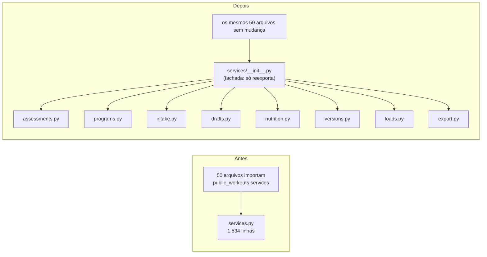

<!--
ARQUIVO: plano para dividir os arquivos Python e templates grandes do OctoBox sem mudar comportamento.
STATUS: proposto em 21/10/2026; nenhuma fase executada.
ESCOPO: public_workouts (models, services, templatetags), student_app/views/public_workout_views.py,
  student_identity/public_workout_views.py e templates/public_workouts/workout.html.
FRONTEIRA: só organização de código. Nenhuma regra, URL, migração de dados ou contrato de API muda.
DEPENDE DE: docs/architecture/architecture-growth-plan.md (Fase 1: "reduzir acoplamento escondido",
  "não mover modelos de forma agressiva") e da suíte atual (3.126 testes no servidor + e2e da Curva).
SKILL USADA: software-architecture-chief.
-->

# Plano: dividir os arquivos grandes sem quebrar nada

## Para quem não é desenvolvedor

Hoje alguns arquivos têm 1.000 a 1.500 linhas. Funciona, mas é como uma cozinha onde tudo fica numa
gaveta só: cada mudança mexe na mesma gaveta, duas pessoas brigam por ela ao mesmo tempo e fica fácil
quebrar algo sem querer.

O plano muda de casa **cômodo por cômodo**, nunca tudo de uma vez:

1. **Antes de mexer**, tiramos "fotos" de como as telas e as funções respondem hoje (testes de
   caracterização). Depois da mudança, as fotos têm que sair idênticas.
2. **Cada mudança só move código.** Nenhuma regra muda junto, o que deixa a revisão fácil: "só mudou
   de lugar".
3. **O arquivo antigo vira uma recepção** (fachada). Quem procurava `services.record_load` continua
   achando no mesmo endereço; a recepção encaminha para o cômodo novo. Por isso nenhum dos 98
   arquivos que usam `models` nem dos 50 que usam `services` precisa mudar.
4. **Um arquivo por vez**, com todos os testes automáticos verdes antes de juntar. Se algo der errado,
   desfazer é um clique (reverter um PR que só moveu código).
5. **Uma trava impede o problema de voltar**: um teste falha se um arquivo grande crescer de novo.

Total estimado: 7 PRs pequenos (1 de preparação e 6 de divisão), um por vez, em 2 a 3 semanas de ritmo leve.

## 1. Contexto

- **Problema:** os arquivos mais editados do produto são também os maiores. Isso gera conflito entre
  PRs paralelos (vimos esta semana o número de versão do cache brigando entre 3 PRs), revisões
  difíceis e medo de mexer, que o growth plan lista como sinal de "arquitetura doente".
- **Objetivo:** cada arquivo com um assunto só e até ~500 linhas, sem nenhuma mudança de
  comportamento.
- **Restrições:** produção ativa com clientes reais; deploy automático a cada merge no `main`;
  vários PRs e sessões abertos ao mesmo tempo; só PostgreSQL; time pequeno, com IA escrevendo boa
  parte do código.
- **Premissa:** a suíte atual é a rede de segurança principal: 3.126 testes no servidor rodados em
  4 ordens, mais os e2e da Curva (guiado, PWA, push) e os checks de migração e segurança no CI.

## 2. Auditoria (medida em 21/10/2026 no `main` 6a0c8ca0)

| Arquivo | Linhas | Commits em 90 dias | Quem importa | `patch()` em testes |
|---|---:|---:|---:|---:|
| `student_app/views/public_workout_views.py` | 1.332 | **53** | 5 arquivos | 0 |
| `templates/public_workouts/workout.html` | 772 | **44** | (template) | — |
| `public_workouts/models.py` | 1.539 | 34 | **98 arquivos** | 0 |
| `public_workouts/templatetags/public_workouts_extras.py` | 988 | 29 | templates + 2 arquivos | 0 |
| `student_identity/public_workout_views.py` | 1.200 | 29 | URLs | **5 alvos** |
| `public_workouts/services.py` | 1.534 | 26 | **50 arquivos** | 1 alvo |
| `public_workouts/parser.py` | 1.088 | 6 | 3 arquivos | 0 |
| `catalog/views/student_views.py` | 1.077 | 2 | URLs | 4 alvos |
| `static/js/public_workouts/workout-guided.js` | 1.022 | 7 | (script) | — |

**O que já está bom e deve ser preservado**

- Os assuntos dentro de cada arquivo já são separáveis. `services.py`, por exemplo, tem blocos
  contínuos de avaliação física (linhas 89–403), publicação de programa (412–556), intake (566–719),
  rascunhos (722–886), plano alimentar (889–957), versões (960–997), registro de carga (1013–1471)
  e exportação LGPD (1474–1534).
- `models.py` não tem *signals* e nenhum teste faz `patch()` nele.
- O guiado no navegador já nasceu dividido (guided-state, format, ring, timer, focus e controller).

**Riscos reais, do maior para o menor**

1. **`patch()` apontando para o endereço antigo.** Um teste que faz
   `patch('student_identity.public_workout_views.start_subscription_checkout')` só funciona se o código
   que chama a função procurar o nome nesse módulo. Se a view mudar de arquivo e o patch continuar no
   endereço antigo, o teste **passa a chamar o Stripe de verdade** (ou deixa de testar). São 5 alvos em
   `student_identity/public_workout_views.py`, 4 em `catalog/views/student_views.py` e 1 em
   `services.py`.
2. **PRs abertos mexendo no mesmo arquivo.** Um PR antigo que edita a linha 1.200 de `services.py`
   vira um conflito difícil depois que o código mudou de arquivo. Mover código com PR concorrente
   aberto é o jeito mais fácil de perder uma correção.
3. **Templatetags mudando de tipo sem perceber.** `@register.filter` e `@register.simple_tag` se
   comportam diferente no template, inclusive no escape de HTML. Recadastrar um filtro como tag
   quebra a tela sem erro claro.
4. **Models e migrações.** Mover um model de arquivo não deve gerar migração. Se gerar, é sinal de
   mudança acidental. Há 16 FKs que apontam por classe e podem virar import circular.
5. **Testes que leem o arquivo pelo caminho.** Três testes abrem `public_workouts/services.py` como
   texto para checar importações: `public_workouts/test_program.py:174`,
   `public_workouts/test_weekly_review.py:156` e `tests/test_public_workout_access_split.py`. Quando
   `services.py` virar pacote, esse arquivo deixa de existir e os três quebram.
6. **Variáveis de template.** No `workout.html`, variáveis criadas com `` no topo são
   usadas lá embaixo. Um `` herda o contexto, mas um bloco `` não vaza.

## 3. Direção

**Forma alvo: pacotes por assunto, com fachada no endereço antigo** (monólito modular, a mesma
direção do growth plan). Sem renomear nada público, sem mudar regra e sem microserviço.

**Muda agora:** os 5 arquivos mais quentes e o `models.py`.
**Fica como está:** `parser.py` (6 commits/90d), `catalog/views/student_views.py` (2) e o JS do guiado
(7 e 4). Esses só entram na regra de tamanho e são divididos quando alguém precisar mexer neles.
**Espera:** remover as fachadas. Elas custam quase nada e podem ficar para sempre.

## 4. Trade-offs

| Escolha | Ganha | Paga |
|---|---|---|
| Fachada no endereço antigo | Nenhum dos 98 importadores muda; PR pequeno; reversão simples | Dois caminhos para o mesmo nome (novo e fachada). Por isso, código novo importa do módulo novo. |
| PR que só move código | Revisão em minutos com `git diff --color-moved`; risco perto de zero | A limpeza de verdade (nomes, duplicações) fica para depois, em PRs separados |
| Um arquivo por PR, em fila | Nenhum conflito entre os próprios splits | Leva semanas, não um dia |
| Congelar o arquivo durante o split | Nenhuma correção perdida em conflito | Um ou dois dias sem mexer naquele arquivo |
| `models.py` por último | O mais arriscado chega com a técnica já ensaiada 4 vezes | O maior arquivo continua grande por mais tempo |

## 5. Decisões (ADR)

**ADR-1: fachada em vez de atualizar importadores.**
Status: proposta. Contexto: 98 importadores de `models` e 50 de `services`. Escolha: o módulo antigo
reexporta explicitamente (`from .loads import record_load, correct_load, ...` com `__all__`).
Alternativa descartada: atualizar todos os importadores no mesmo PR, o que dá um diff gigante,
conflita com todo PR aberto e fica difícil de revisar. Consequência: duas formas de importar.
A regra é que código novo usa o módulo novo, e o teste de contrato (Fase 0) garante que a
fachada nunca perde um nome.

**ADR-2: patch onde o nome é procurado, e nunca na fachada.**
Status: proposta. Contexto: o risco 1. Escolha: no mesmo PR do split, cada `patch('modulo_antigo.X')`
passa a apontar para o módulo onde o código que usa `X` mora agora. Um teste-guarda (Fase 0) falha
se algum `patch()` mirar um nome que a fachada só reexporta.
Exceção: o patch na fachada continua valendo quando quem chama faz o import dentro da função, na
hora da chamada. É o caso das views que usam `get_active_program`
(`student_app/views/public_workout_access.py:46`). Mas o mesmo teste também chama
`_validate_plan_slug`, que dentro de `services` chama `get_active_program` como global do próprio
módulo. Esse caminho **quebra** se o patch ficar na fachada (detalhe na Fase 3). Cada exceção entra
numa lista explícita no guarda, com o motivo.

**ADR-3: models por último, com FK por string e prova de "nenhuma migração".**
Status: proposta. Escolha: `models.py` vira `models/__init__.py` (importa todos os models) mais
submódulos. As FKs entre submódulos passam a usar string (`'public_workouts.PublicWorkoutAccount'`).
O Django já guarda FK como string na migração, então nada muda no banco. Critério de aceite:
`makemigrations --check` sem mudanças (o CI já roda `migration-check`) e o autodetector "sem
mudanças" também localmente.

**ADR-4: trava de tamanho (ratchet).**
Status: proposta. Escolha: um teste lista o teto de linhas de cada arquivo grande (o tamanho atual) e
600 linhas para qualquer arquivo novo. Arquivo pode encolher, nunca crescer. Sem isso, o problema
volta em 6 meses.

## 6. Caminho de migração

### Fase 0: rede de segurança (1 PR, sem mover nada)

Objetivo: tirar as "fotos" antes da mudança.

1. **Teste de contrato de importação.** Para cada módulo que vai virar fachada, uma lista congelada
   dos nomes públicos (classes, funções, constantes e exceções) que hoje se importam dele. O teste
   falha se algum nome sumir.
2. **Teste de caracterização do HTML (golden master).** Renderiza `/renan/<slug>` para 4 alunos de
   fixture e guarda o HTML normalizado (sem token CSRF nem versão de asset):
   - sem histórico;
   - com carga e periodização;
   - com treino guiado em andamento;
   - com pagamento bloqueado.

   O split dos templatetags, das views e do `workout.html` tem que manter esse HTML idêntico. É
   descartável: sai depois da Fase 5.
3. **Snapshot da biblioteca de templatetags.** O nome, o tipo (filter ou simple_tag) e as opções de
   cada um dos 37 registros de `public_workouts_extras`. O teste falha se algum mudar.
4. **Guarda de `patch()` em fachada** (ADR-2).
5. **Trava de tamanho** (ADR-4).

Sucesso: os testes novos passam no `main` atual sem mudar nenhuma linha de produção.

### Fase 1: templatetags → `public_workouts/presenters/` (988 linhas, risco baixo)

- A lógica sai para funções puras por assunto:
  - `presenters/program_cards.py`: resumo, semana, saudação, dia;
  - `presenters/movements.py`: nome, variações, glossário, fases de reps, série guiada;
  - `presenters/progress_charts.py`: curva, recorde, compartilhar (~350 linhas);
  - `presenters/periodization.py`: banner, semana e fase atual;
  - `presenters/todays_load.py`: carga de hoje e `movement_load_display`.
- `public_workouts_extras.py` continua sendo a biblioteca que os templates carregam, só com os
  registros (`register.filter('movement_name', movement_name)`). Nenhum `` muda.
- Aceite: snapshot da biblioteca igual, golden master igual e suíte inteira verde.

### Fase 2: `student_app/views/public_workout_views.py` → `student_app/views/public_workout/` (1.332 linhas, o mais quente)

- `rendering.py`: montagem do HTML, PWA e templates legados (~370);
- `pages.py`: Detail, Preview e TemplatePreview (~300);
- `records.py`: RecordLoad, RecordAssessment e os parsers de número (~300);
- `data.py`: Package, WeeklyReview, MealPlan, Export e PDF (~180);
- `session.py`: SignOut, OnboardingComplete e LocalStorageBackup (~90).

O arquivo antigo vira fachada. `public_urls.py` importa de `student_app/views/__init__.py`, que reexporta de `public_workout_views`, então nem as URLs nem esse `__init__` mudam. Aceite: golden master igual e e2e da Curva
verdes.

### Fase 3: `public_workouts/services.py` → `public_workouts/services/` (1.534 linhas)

- Os blocos da auditoria viram `assessments`, `programs`, `intake`, `drafts`, `nutrition`,
  `versions`, `loads` e `export`.
- Os helpers privados (`_num`, `_serialize_load_log`…) vão junto com quem os usa.
- Dependências entre os módulos novos são explícitas: `drafts` importa `publish_program` de
  `programs`.
- `is_known_plan_slug`, `_validate_plan_slug` e `get_active_program` vão juntos para
  `services/programs.py`. Os patches de `tests/test_public_workout_access_split.py` que exercitam
  `_validate_plan_slug` passam a mirar `public_workouts.services.programs.get_active_program`. Os que
  passam pela view podem continuar na fachada, porque a view importa na hora da chamada.
- Os 3 testes que leem `public_workouts/services.py` como texto (risco 5) passam a ler todos os
  arquivos de `public_workouts/services/`. A verificação deles continua a mesma (por exemplo, "services
  não importa a view").
- Aceite: teste de contrato e suíte inteira verdes, incluindo os testes de idempotência e de corrida
  de `record_load`, `correct_load` e do token.

### Fase 4: `student_identity/public_workout_views.py` → `student_identity/public_workout/` (1.200 linhas)

- `landing.py`, `analytics.py`, `auth.py` (login, Google e saída), `checkout.py` (assinatura,
  cadastro, checkout, portal de cobrança) e `account.py` (intake, conta, reembolso).
- **No mesmo PR**, os 5 alvos de `patch()` passam para o módulo novo:
  - `start_subscription_checkout` (3 testes), `start_checkout_lead_session` (3),
    `start_customer_portal_session` (2) e `start_custom_price_subscription_checkout` (2) vão para
    `checkout.<nome>`;
  - `_build_public_workout_google_provider` (1) vai para `auth.<nome>`.
- Aceite: guarda de patch verde e nenhum teste de checkout fazendo chamada de rede. Conferir com o
  log de testes e, se preciso, um bloqueio de rede no teste.

### Fase 5: `public_workouts/models.py` → `public_workouts/models/` (1.539 linhas, o de maior risco)

- Submódulos:
  - `catalog` (movimentos, profissionais);
  - `programs` (programa, entregas, rascunhos, outbox);
  - `accounts` (conta, token, backup local, push);
  - `training` (sessão, série, revisões, aviso de descanso, carga, cache semanal);
  - `profiles` (treino, nutrição, plano alimentar);
  - `commerce` (assinatura, eventos, lead, pagamento, reembolso, aviso);
  - `growth` (experimentos, aquisição, funil, lista de espera, depoimentos, métricas, campanha);
  - `assessments` e `operations` (work items, credencial).
- `models/__init__.py` importa todos (o registro do Django exige) e serve de fachada.
- As 16 FKs por classe viram string só onde cruzam submódulos.
- Aceite: autodetector e `makemigrations --check` sem mudanças, `manage.py check` limpo e suíte inteira
  verde. O ideal é rodar também contra uma cópia do banco de produção.

### Fase 6: `workout.html` → mais parciais (772 linhas, 44 commits)

- Uma parcial por aba e bloco: hero, treino, progresso e perfil.
- As variáveis do topo (`current_phase`, `phase_banner`, `workout_selection`) continuam sendo criadas
  no `workout.html` antes dos ``.
- Aceite: golden master idêntico. No fim desta fase, ele sai e o ratchet fica.

### Rollback e contenção, em todas as fases

- Cada PR é só movimento e não tem migração nem dado, então reverter é um `git revert` daquele PR.
- **Congelamento:** antes de abrir o split, não pode haver PR aberto editando o arquivo. Se houver,
  ele entra antes ou espera. O split entra sozinho, e os PRs seguintes partem do `main` novo.
- Deploy em horário de baixo uso. Depois do deploy, conferir a home e o guiado de um aluno de teste.

## 7. Regras de ouro de cada PR de split

1. Só mover. Não renomear nada público, não "aproveitar para melhorar", não trocar ordem de lógica.
2. Primeiro commit: o arquivo novo e a fachada. Segundo commit: só os testes (patches e testes que
   leem o arquivo pelo caminho). Antes de abrir o PR, procurar no repositório o caminho antigo
   (`grep -rn "services.py"` etc.) para achar testes e comentários que apontam para ele.
3. Revisar com `git diff -M --color-moved=dimmed-zebra`. Linha que não aparece como "movida" precisa
   de justificativa.
4. Rodar local:
   - a suíte inteira com `--create-db --migrations -n 4`;
   - os e2e da Curva (guiado, PWA e push);
   - `node --test tests/js/*.test.js` quando tocar em template;
   - o autodetector quando tocar em models.
5. Esperar o CI inteiro verde: full suite, ordem 42/137/9999, tenant-boundary, migration-check e
   security-audit.
6. Merge com squash, e nada mais entra no `main` até o deploy daquele PR terminar.

## 8. Guardas operacionais

- **Observabilidade:** o check pós-deploy que compara o SHA em produção já existe. Nas primeiras
  horas depois de cada fase, olhar os erros 500 no log (`fetch-vps-logs`).
- **Segurança:** nenhum ponto de autenticação ou permissão muda de lugar sem levar o teste junto.
  Fases 4 e 5 têm revisão humana obrigatória (login, checkout e models).
- **Performance:** import de pacote custa o mesmo que import de módulo. Nenhuma query muda, porque o
  código não muda.
- **Custo:** zero de infraestrutura, só tempo de revisão.

## 9. Validação

- **Prova de que deu certo:**
  - nenhuma linha de comportamento mudou: golden master, contratos e snapshot verdes;
  - os arquivos alvo ficam com menos de ~500 linhas;
  - os PRs seguintes que mexem em carga, avaliação ou checkout tocam 1 arquivo pequeno em vez do
    gigante;
  - menos conflitos de merge.
- **Sinais de que a decisão está errada:**
  - algum split precisou mudar teste além dos `patch()` e do contrato;
  - apareceu migração ao mover models;
  - o tempo de revisão dos PRs de split passou de 1 hora.

  Nesses casos, parar, reverter e repensar aquele arquivo.
- **Quando não fazer:** em semana de lançamento ou com incidente aberto. Organização de código nunca
  tem prioridade sobre estabilidade em produção.
