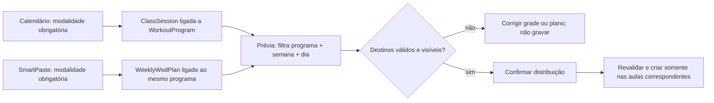

<!--
ARQUIVO: plano de alinhamento entre calendario, modalidade e distribuicao do SmartPaste.
TIPO: plano de produto, arquitetura incremental e QA.
AUTORIDADE: proposta para revisao de PM/Owner/Tech Lead; runtime e testes vigentes prevalecem.
DOCUMENTOS RELACIONADOS:
- [wod-weekly-programming-and-distribution-plan.md](wod-weekly-programming-and-distribution-plan.md)
- [../reference/reading-guide.md](../reference/reading-guide.md)
STATUS: implementacao local em andamento; QA focado aprovado, E2E completo e rollout ainda pendentes.
-->

# Modalidade no calendário e roteamento do SmartPaste

## Decisão em uma frase

Cada aula pertence a uma modalidade de programação explícita; cada plano semanal do SmartPaste pertence a uma modalidade; a distribuição só pode atingir aulas da mesma modalidade. O nome da aula é para reconhecimento humano, nunca é a chave que decide onde o WOD será aplicado.

## 1. Contexto, objetivo e premissas

O box pode programar CrossFit, HYROX, mobilidade/alongamento, força e outras trilhas na mesma semana. A equipe precisa criar a grade uma vez por trilha e colar/programar cada semana sem que uma modalidade sobrescreva ou receba o treino de outra.

Premissas do MVP:

1. Uma aula (`ClassSession`) representa uma turma/ocorrência com uma modalidade principal.
2. Uma aula pode ocorrer no mesmo dia — e, se a operação permitir, no mesmo horário — que outra modalidade, mas são registros de turma distintos.
3. Uma aula não recebe simultaneamente dois programas semanais independentes. Se isso virar requisito, será uma evolução de domínio, não uma seleção múltipla improvisada no calendário.
4. “Alongamento” é apresentado ao usuário usando o nome configurado do programa (atualmente o programa padrão é “Alongamento e mobilidade”).

## 2. Auditoria do estado encontrado

### O que já funciona e deve ser preservado

- `ClassSession` já tem `workout_program` e `class_type`; `WorkoutProgram` guarda nome, slug e tipos de bloco permitidos.
- O formulário de grade recorrente e o de edição já mostram modalidade; o comando de criação carrega `workout_program_id` até a persistência.
- `WeeklyWodPlan` guarda a modalidade escolhida no SmartPaste.
- A prévia de projeção filtra por `workout_program_id` quando o plano tem modalidade. O teste `test_program_track_routes_only_to_matching_sessions` prova que um plano CrossFit não inclui a aula HYROX e vice-versa para mobilidade.
- O lote evita sobrescrever WOD que a aula já possui; a política atual pula esse destino e mostra o resultado.

### Gaps identificados na auditoria inicial (estado do código após as correções locais)

1. **Default silencioso:** corrigido nos formulários de calendário e seleção visível do SmartPaste: novos fluxos exibem placeholder e exigem modalidade. POSTs antigos do SmartPaste que omitem o campo continuam com fallback CrossFit por compatibilidade; é uma dívida deliberada a medir e remover, não o contrato da UI.
2. **Título não corrige seleção explícita:** continua intencionalmente assim. O usuário seleciona a modalidade e o título não altera a rota sem consentimento; agora o formulário explica essa relação.
3. **Duplicidade sem modalidade:** corrigido na geração recorrente: a consulta inclui programa além de título e horário. Ainda precisamos definir e testar separadamente colisões de coach/sala/capacidade para turmas realmente simultâneas.
4. **Fallback legado:** planos antigos sem `workout_program` ainda dependem de `class_type`. Esse caminho é útil para compatibilidade, mas deve ser observável e não pode virar fallback silencioso de planos novos.
5. **Associação nullable:** `ClassSession.workout_program` aceita `NULL`. O caminho normal tenta preencher no `save()`, mas importadores, dados históricos e fluxos alternativos precisam ser auditados antes de depender de obrigatoriedade no banco.
6. **Conflito de recursos:** permitir modalidades distintas no mesmo horário não deve permitir inadvertidamente o mesmo coach em duas turmas simultâneas; modalidade diferente não elimina conflito de agenda, capacidade ou recursos.

## 3. Fluxo de produto recomendado

### Calendário / criação de grade

1. O coach escolhe **Modalidade** antes de gerar a recorrência: CrossFit, HYROX, Alongamento e mobilidade, etc.
2. A escolha é obrigatória e não vem pré-selecionada silenciosamente. Pode haver uma escolha recente como sugestão visual, mas ela deve exigir confirmação explícita e aparecer no resumo antes de salvar.
3. O nome da aula continua editável e amigável: “CrossFit 07h”, “HYROX 18h”, “Alongamento 19h”. Nome e modalidade aparecem juntos na revisão da recorrência.
4. A confirmação mostra quantidade de aulas e resumo por modalidade/dia/horário; duplicidades são descritas como “mesma modalidade, nome e horário já existentes”.
5. Repetir o processo para outra modalidade cria uma trilha paralela; a identidade de deduplicação passa a incluir modalidade: `(data/hora, modalidade, nome normalizado)`.
6. Antes de permitir aulas simultâneas, validar conflitos de coach e limites operacionais existentes. Não deduplicar turmas de modalidades diferentes apenas por coincidência de título e horário.
7. Na edição rápida, a modalidade atual fica visível e é mantida se o campo não fizer parte da alteração; uma troca explícita atualiza a trilha e informa que WOD já existente não será movido automaticamente.

### WOD Semana / SmartPaste

1. Selecionar modalidade antes de colar/organizar: “Programação da semana para: HYROX”. Sem seleção, não organizar nem distribuir.
2. A semana e a modalidade formam o escopo do plano. Alterar modalidade depois de organizar invalida a prévia e exige recalcular/revisar destinos.
3. A prévia usa filtro canônico por `WorkoutProgram` e lista todas as aulas correspondentes por dia, com contadores de prontas, já com WOD, sem prescrição naquele dia e canceladas.
4. Se não houver turma da modalidade na semana, bloquear a distribuição e oferecer corrigir calendário ou modalidade — sem fallback para CrossFit/`class_type`.
5. O resumo de confirmação repete modalidade e destinos: “Distribuir HYROX para 5 aulas”. Destinos de outras modalidades não aparecem como elegíveis; opcionalmente aparecem em uma linha informativa de exclusão (“2 aulas de CrossFit não serão alteradas”).
6. No POST, recalcular os destinos com a mesma regra da prévia. Se modalidade, grade, status ou ocupação mudou, apresentar resultado atualizado antes de escrever, conforme as proteções já existentes.
7. Preservar a política de não sobrescrever, idempotência, aprovação/publicação por papel e consumo do aluno. Distribuir um plano não equivale a publicar automaticamente.

## 4. Decisões de arquitetura (ADR curto)

### ADR-1 — `WorkoutProgram` é a chave de roteamento

- **Status:** recomendado.
- **Decisão:** usar o FK canônico de programa tanto na aula quanto no plano semanal; `class_type` continua como classificação operacional/compatibilidade.
- **Alternativas rejeitadas:** deduzir modalidade do nome; enviar ao mesmo dia todas as aulas; manter seleção múltipla de tipos como autoridade paralela.
- **Consequência:** o nome pode mudar sem redirecionar treino; cadastro exige programa existente e ativo.

### ADR-2 — uma modalidade principal por aula

- **Status:** recomendado para MVP.
- **Decisão:** CrossFit e HYROX no mesmo dia são turmas diferentes, cada uma com seu `ClassSession` e programa.
- **Alternativa adiada:** múltiplos programas ou WODs compostos numa mesma aula.
- **Consequência:** fluxo simples e previsível; uma turma genuinamente híbrida exigirá uma decisão de produto e outro contrato de prescrição.

### ADR-3 — ausência de modalidade bloqueia novos fluxos

- **Status:** recomendado, após compatibilidade/backfill.
- **Decisão:** formulários e commands novos exigem escolha; manter leitura controlada de registros legados enquanto se mede e saneia `NULL`/planos sem programa.
- **Alternativa rejeitada:** default silencioso para CrossFit.
- **Consequência:** uma etapa extra de seleção, compensada por evitar distribuição errada e tornar erros corrigíveis antes da gravação.

## 5. Plano de entrega incremental

| Fase | Mudanças | Dependências / contenção | Critério de sucesso |
|---|---|---|---|
| 0. Baseline e dados | Medir sessões sem programa, programas inativos, planos sem programa e conflitos de nome/horário; definir política para turmas paralelas e coach simultâneo | Só leitura; não reclassificar dados automaticamente | Relatório por tenant e amostra revisada pelo Owner |
| 1. Contrato da grade | Tornar modalidade explícita nos forms e commands; remover fallback CrossFit em requests novos; exibir modalidade em listas e revisão | Manter compatibilidade da API/import legado até inventário | POST ausente/inválido rejeitado; novo registro sempre tem programa ativo |
| 2. Duplicidade e recursos | Escopar deduplicação por modalidade; permitir mesmo nome/horário em modalidades diferentes; bloquear/avisar conflito de coach conforme política | Usar chaves de teste e revisar regra de agenda antes de deploy | CrossFit + HYROX coexistem sem falso skip; duplicata real segue detectada |
| 3. SmartPaste explícito | Seleção necessária antes de parse/confirmar; plano e fingerprint idempotente incluem programa; prévia apresenta modalidade e contagens | Invalidar preview ao mudar modalidade; preservar rascunho | Nenhum plano novo distribuído sem programa e preview atual |
| 4. Distribuição e app do aluno | Revalidar mesma modalidade no preview/POST; estado por destino; confirmar apenas aulas correspondentes | Não sobrescrever; manter aprovação e publicação atuais | WOD de aluno corresponde à aula e modalidade; trilhas vizinhas permanecem inalteradas |
| 5. QA e rollout | E2E crossfit+HYROX+mobilidade; QA por papel e dispositivo; rollout gradual com métrica de mismatch | Feature flag se o risco de dados/UX justificar; rollback é desativar novas gravações, não apagar programas | Zero destino cruzado; sem regressão no calendário, aprovação e app aluno |

## 6. Matriz de teste do plano

| Cenário | Resultado esperado | Evidência atual / teste necessário |
|---|---|---|
| Criar recorrência CrossFit e outra HYROX no mesmo dia, com nomes iguais e mesmo horário | Duas turmas válidas, programas distintos; conflito de coach avaliado separadamente | Coberto pela chave da store e teste de integração; conflito de coach continua política separada |
| Tentar criar aula sem modalidade | Erro no campo; nenhuma sessão criada | Coberto no formulário e validado também no command de escrita |
| Nome “HYROX”, seletor CrossFit | Bloquear incoerência ou salvar CrossFit somente com seleção explícita visível; não inferir pelo título sem consentimento | **Gap confirmado:** seleção explícita prevalece sobre inferência de título. UX deve impedir erro acidental |
| Criar plano SmartPaste HYROX para semana com aulas CrossFit e HYROX | Prévia contém só HYROX; confirmar não toca CrossFit | **Parcialmente coberto:** `test_program_track_routes_only_to_matching_sessions` prova filtro na prévia. Acrescentar distribuição real/assert de não alteração |
| Repetir para CrossFit e mobilidade | Cada plano seleciona só sua trilha, mesmo com datas iguais | **Parcialmente coberto:** teste de projeção também verifica mobilidade fora do CrossFit; cobrir fluxo end-to-end por modalidade |
| Modalidade selecionada não tem aula naquele intervalo | Bloquear sem criar `ReplicationBatch`/WOD e orientar calendário | Há caminho de bloqueio sem destinos; adicionar assert específico de mensagem e modalidade |
| Aula cancelada ou com WOD existente | Cancelada excluída; ocupada aparece como ignorada e não é sobrescrita | Já há cobertura de projeção; manter e integrar à matriz multi-modalidade |
| Trocar modalidade entre prévia e confirmação | Prévia fica obsoleta; POST revalida ou rejeita; não grava em outra trilha | Revalidar especificamente mudança do FK/programa na semana |
| Editar modalidade de aula que já tem WOD | Avisar; não mover, apagar nem publicar WOD automaticamente | Necessita teste de política e mensagem explícita |
| Repetir POST após timeout | Mesmo lote recuperado; nenhum WOD duplicado ou roteado a outro programa | Infra de idempotência existe; assegurar `workout_program_id` no fingerprint |
| Coach tem duas turmas simultâneas em programas diferentes | Aplicar política de conflito de recurso, não tratar como deduplicação de WOD | Confirmar regra de negócio; não está provado por este fluxo |
| Aluno abre WOD após distribuição/aprovação | Só vê WOD publicado da sua aula/data; não recebe trilha vizinha | Reutilizar E2E de round-trip aluno e criar caso multi-modalidade |

### Simulação de QA (cenários e resultado)

Com duas aulas na quarta às 19h — “Aula” CrossFit e “Aula” HYROX — e dois planos para a mesma semana:

1. O calendário grava duas sessões com programas diferentes; a chave de duplicidade não confunde as turmas.
2. A prévia do plano CrossFit lista somente a sessão CrossFit; a prévia HYROX lista somente a sessão HYROX.
3. Confirmar CrossFit não cria nem altera `SessionWorkout` da aula HYROX; o inverso também é verdadeiro.
4. Uma terceira programação de mobilidade sem turma correspondente não cria lote e explica como corrigir.
5. Se o coach alterar uma das aulas após a prévia, a confirmação recalcula destinos; não aplica uma prévia obsoleta.

**Resultado do QA local (30/09/2026):** `manage.py check` passou, `makemigrations --check --dry-run` não detectou alterações faltantes, 84 testes focados passaram em PostgreSQL com schema `box_test` e o E2E browser `test_smart_paste_golden_path_end_to_end` passou. A cobertura exercita campo obrigatório, coexistência/deduplicação por programa, bloqueio de reclassificação de aula com WOD, isolamento da projeção/distribuição CrossFit vs HYROX e compatibilidade de POST antigo.

**Ainda não é prova de ponta a ponta em produção:** não foi executado browser E2E da jornada completa criar calendário → criar dois planos → confirmar distribuição → conferir aluno, nem rollout por tenant. Não escalar tráfego antes desses gates. Confirmar também a política de recursos simultâneos e medir o uso do fallback legado do SmartPaste.

## 7. Guardrails operacionais

- Registrar contadores sem texto do treino: sessões criadas por modalidade, tentativas bloqueadas por modalidade ausente, distribuições sem destino, skips por WOD existente e mismatch plano/aula.
- Não logar texto colado, dados pessoais de alunos ou payload completo do WOD para medir roteamento.
- Idempotência inclui box/tenant, plano, conteúdo, semana, modalidade e ator; replay do mesmo pedido retorna o lote existente.
- Uma modalidade inativa não pode ser escolhida para nova aula/plano; registros históricos continuam legíveis.
- Mudanças de modalidade não devem reclassificar silenciosamente aulas existentes nem deslocar WOD já publicado.
- Revisar query count da prévia após filtrar por FK; evitar uma query por sessão.

## 8. Critérios de aceite / pronto

1. Todo novo `ClassSession` criado pela grade e todo novo `WeeklyWodPlan` possuem `WorkoutProgram` ativo.
2. Nome e modalidade podem divergir apenas por decisão explícita; título nunca muda o roteamento silenciosamente.
3. A mesma janela pode conter modalidades diferentes sem falso positivo de duplicidade, respeitando conflitos reais de recursos.
4. A prévia e a gravação usam a mesma regra canônica de `(tenant, semana local, weekday, workout_program, status)`.
5. Nenhum WOD é aplicado a modalidade diferente; aulas sem programa e sem correspondência não recebem fallback.
6. Aulas sem WOD, com WOD existente e canceladas têm estado distinto na prévia.
7. Repetição/timeout, aprovação e leitura no app do aluno mantêm idempotência e isolamento por aula.
8. Testes unitários, integração com PostgreSQL tenant e E2E browser provam os critérios; SQLite isolado não conta como prova de concorrência ou isolamento tenant.

## 9. Trade-offs e pontos de decisão

- **Menos erro vs. menos cliques:** remover default implícito acrescenta uma escolha, mas elimina uma classe de erro silencioso. Uma sugestão recente pode reduzir atrito sem enviar valor oculto.
- **Identidade de duplicidade:** incluir modalidade permite turmas paralelas, mas dois registros realmente duplicados da mesma modalidade continuam sendo tratados como duplicata. Mudança de nome pode afetar essa detecção; normalização deve ser limitada e testada.
- **Compatibilidade:** manter fallback para legado reduz risco imediato, mas prolonga dois caminhos. Medir e planejar retirada; proibir fallback em planos novos.
- **Concorrência de horário:** modalidade não deve ser usada para contornar disponibilidade de coach, sala ou capacidade; validar esses recursos é separado do roteamento do WOD.
- **Escopo futuro:** se uma aula puder conter CrossFit + HYROX como um produto único, esta proposta deixa de ser suficiente; primeiro definir se são blocos de uma prescrição composta ou duas turmas independentes.

## 10. Analogia simples

Pense na modalidade como o endereço da caixa de entrega e no nome da aula como o nome escrito na etiqueta para humanos. “Aula das 19h” pode existir em duas caixas; o WOD só vai para a caixa HYROX se o plano também estiver endereçado a HYROX. O texto do nome não deve decidir o endereço.
